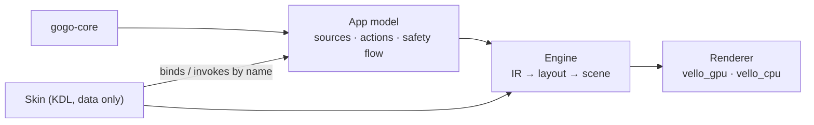
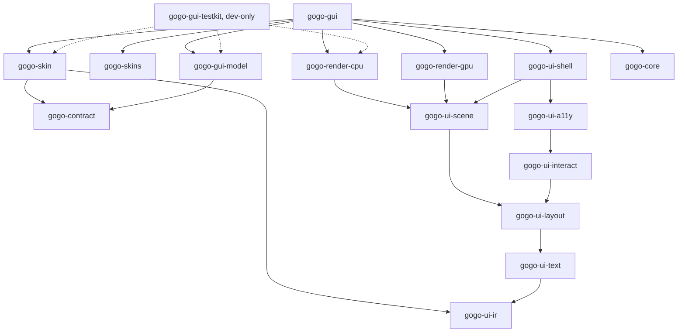

# 24 — Desktop GUI: architecture (#520)

Status: **accepted** (2026-11-25; decisions 1–12 in §1 accepted as recommended). Nothing
is built yet; the port order is §8 and the epic is #520. Numbers marked *measured* come
from a prototype built before this design (2026-11, Linux, a discrete NVIDIA GPU and Mesa's
lavapipe), the same crates and versions as §3. The app layer is design 25. The skin contract
is design 26, the skin format design 27 and the renderers design 28 (all three added in
#557).

Naming: "decision N" is a numbered item of §1. "PR B1", "PR D1" and so on are the port
order's PRs (§8), never decisions.

gogo gets an official desktop GUI for Linux and macOS with **real skins**: not colour
themes, but declarative files that decide layout and look. The app owns the data, the
actions, the routes and an unskippable safety flow. Skins decide *where* and *how*.

## 1. Decisions

1. **Our own engine, not a toolkit.** A prototype rendered the same three skins (a calm
   default, an effect-heavy "Instrument" skin and a flat "Slab" skin) from one KDL file
   in three candidates: our own engine on taffy + parley + vello, egui, and Slint.
   - **Why ours:**
     - It drew the full effect list best: shadow, inner shadow, glow, text bloom,
       gradient, noise, scanlines, reflection and backdrop blur.
     - HiDPI is exact.
     - It had the best text.
     - It is the reference for layout.
     - Its frame times were the best (§6).
     - It brings no toolkit dependency.
   - **egui** scored slightly higher overall, because it ships text input, scrolling and
     popups that we have to build ourselves. But its CPU path needs our own work for the
     effects, and skins would always be translated into immediate-mode calls.
   - **Slint** was last. Skins would have to be translated into `.slint`. Its licences are
     GPLv3, which doesn't fit gogo's MIT/Apache-2.0, or a royalty-free licence that is
     unclear about apps that let third parties write UI. And it is a toolkit with a
     paid commercial edition to depend on.
   - **The cost** is that a v1 has to build what a toolkit would have given: text input
     and IME, scrolling, popups, focus traversal, AccessKit wiring and damage tracking.
     Sub-issues of #520 track each one.
2. **Many small crates (§2), split along the seams we expect to swap.** taffy, parley,
   vello and accesskit break their APIs on most minor releases. Each lives behind one
   crate, so a bump or a replacement touches one place.
3. **A separate `gogo-gui` binary and nix package.** The `gogo` CLI, and anyone who only
   installs it, gets no wgpu, winit or font stack. Only `gogo-gui` depends on `gogo-core`
   (01's "core depends on no frontend" rule, extended).
4. **The GPU renderer is vello_gpu, and the no-GPU renderer is vello_cpu.**
   - vello_gpu is linebender's renderer meant for production GPU use. Compute `vello` is now
     marked experimental, and vello_gpu ran about 2× faster than it in the prototype (§6).
   - vello_gpu and vello_cpu share one filter model (blur, drop shadow), which covers most
     of the effect list natively. Backdrop blur is ours on both (design 28 §3).
   - vello_cpu is the reference for golden tests, and the fallback when no GPU adapter
     works.
5. **The windowed no-GPU path presents through `softbuffer`.** When the GPU stack is
   broken, wgpu can't be relied on to present a CPU frame either.
6. **The scene speaks kurbo/peniko.** Both renderers already use these geometry and colour
   types. A renderer outside linebender would need only a thin conversion.
7. **Exact pins for the GUI stack, upgraded as one batch.**
   - These crates are pinned with `=`: vello_gpu / vello_cpu / parley / peniko / kurbo /
     wgpu, winit / accesskit / accesskit_winit, and taffy.
   - They move in lockstep: vello pins a wgpu major, and accesskit_winit pins winit 0.30.
     Upgrades are deliberate PRs, never Dependabot one-offs.
8. **Popups are our own small layer stack, modelled on understory.** We don't depend on
   `understory_overlay`/`understory_anchor` 0.1; they are weeks old. Copying the design is
   cheap.
9. **Linux: Wayland and X11.** winit's adwaita client-side decorations stay on, so GNOME
   windows get a title bar. That pulls in `ttf-parser`, which carries an unmaintained-crate
   advisory; it gets a `deny.toml` ignore with a "revisit when" note. Our own decorations
   would be real work for a small gain.
10. **Fonts are bundled.** Noto Sans (variable, so `wdth` works) and JetBrains Mono, both
    SIL OFL 1.1, ship with their licence texts. System fonts are a fallback only, for
    glyphs the bundled set lacks. Rendering and golden tests are then identical across
    machines, at about 1 MB.
11. **Golden PNGs are committed and compared with a tolerance on vello_cpu** (08 §7). Pixels
    catch effect and font regressions that structural snapshots miss.
12. **GUI CI is path-filtered** (§7), with a lavapipe job for the GPU renderer.

## 2. Crates

`gogo-ui-*` is the generic engine: it knows nothing about gogo, GOG or the contract.
`gogo-skin*` is the skin format and its data. `gogo-gui*` is the gogo-specific app.

| Crate | Purpose | Public surface (sketch) | External deps |
|---|---|---|---|
| `gogo-contract` | The skin contract (design 26) as typed data, no I/O | `ContractVersion`, `Value` and the contract types, source and action catalogues (`ActionSpec {params, kind, tier}`), routes and sections, app widgets with parts/variants/depth, semantic tokens, invariant ids | — |
| `gogo-skin` | The skin format (design 27): load, validate, bind | `SkinPackage::{load, from_files} -> Result<SkinPackage, Report>`, `Report` of `Finding`s (miette `Diagnostic`s with a stable `Code` and a `Level`), `Manifest`, the `ast` with each node's `Resolved` contract specs, `expr::{parse, eval, Scope}` (data lookup); planned (B4): `SkinPackage::bind(route, &dyn Scope, &UiState) -> ir::Tree` | kdl, miette, thiserror |
| `gogo-ui-ir` | The resolved tree: the boundary between "a skin" and "an engine" | `Tree`, `Node`, `Kind`, `LayoutStyle`, `Paint`, `Effect`, `TextStyle`, `Role`/`A11y`, `ActionRef`, `DrawnBy::{App, Skin}` | — |
| `gogo-ui-text` | Fonts, shaping, line breaking, the edit buffer | `FontSet`, `TextLayout`, `GlyphRun`, `EditBuffer` (over parley's `PlainEditor`) | parley, fontique |
| `gogo-ui-layout` | IR → taffy → positioned boxes | `layout(&Tree, &mut FontSet, viewport, scale) -> Laid`, `Laid::{rect, hit}` | taffy |
| `gogo-ui-scene` | The display list and the `Renderer` trait | `DisplayList`, `Op`, `build(&Tree, &Laid)`, `ImageId`, `trait Renderer`, icon paths | kurbo, peniko |
| `gogo-render-cpu` | vello_cpu renderer | `CpuRenderer: Renderer`, `render_to_rgba` | vello_cpu |
| `gogo-render-gpu` | vello_gpu renderer on wgpu | `GpuRenderer: Renderer`, `TextureCache`, `PipelineCache`, readback | vello_gpu, wgpu |
| `gogo-ui-interact` | Input → intents: hit-testing, focus, key routing, scroll state, layer stack, input provenance | `Interaction`, `Intent`, `InputProvenance`, `FocusOrder` | — |
| `gogo-ui-a11y` | IR + layout → AccessKit tree; requests → intents | `tree_update`, `map_request` | accesskit |
| `gogo-ui-shell` | The window: winit loop, surfaces, frame pacing, damage, IME, clipboard, platform a11y, hot-reload watching | `Shell::run(impl ShellApp, RendererChoice)`, `ShellApp`, `Waker` | winit, accesskit_winit, notify, softbuffer, smithay-clipboard (Linux), arboard (macOS) |
| `gogo-gui-model` | The app layer (design 25): sources, dispatch, the safety flow, jobs | `Model`, `trait Backend`, `SourceStore`, `SafetyFlow`, `JobTable`, `UiState` | — |
| `gogo-skins` | Built-in skins as data | `builtin()` (embedded with `include_str!`) | — |
| `gogo-gui` | The binary: wires gogo-core in, owns the tokio runtime, picks a renderer | bin `gogo-gui`, `CoreBackend: Backend` | tokio, image (`jpeg`, `webp`) |
| `gogo-gui-testkit` | Test support, dev-dependency only | fixture `Scope`, `FakeBackend`, procedural covers, golden compare, headless render | png |

Built-in skins and bundled fonts live under `crates/`, because the nix package's source
fileset is `Cargo.toml`, `Cargo.lock`, `crates/` and `compat/` (`nix/app.nix`).

### 2.1 Dependency rules

1. `gogo-core` depends on no GUI crate. Only `gogo-gui` depends on `gogo-core`.
2. `gogo-contract`, `gogo-ui-ir`, `gogo-skin` and `gogo-skins` depend on no layout, text,
   render, window or async crate.
3. `gogo-render-*` depend only on `gogo-ui-scene` and their backend libraries. They never
   see the IR, a skin, the contract, winit or each other.
4. `gogo-ui-shell` knows the `Renderer` trait, not a renderer: `gogo-gui` injects them.
5. `gogo-gui-model` depends only on `gogo-contract`. No IR, skin, renderer, winit or tokio.
6. No `gogo-ui-*` crate names gogo concepts. `ActionRef` is an opaque id to the engine.
7. `gogo-gui-testkit` is only ever a dev-dependency.

CI checks these rules with `cargo metadata` (§7).

### 2.2 What each seam lets us swap

| Seam | Swap |
|---|---|
| contract ↔ skin | The format can change without touching the contract, the model or the engine |
| skin → IR | The engine sees only the IR. App-owned widgets are built as IR by the app, and the engine is tested without KDL |
| text, layout | parley and taffy releases, or replacements, stay in one crate each |
| scene + `Renderer` | GPU ↔ CPU at runtime. A future renderer is a new crate. Golden tests need no GPU |
| render-gpu as its own crate | A CPU-only build carries no wgpu, naga or shader tooling |
| interact, a11y | Input policy, and AccessKit's lockstep bumps, stay out of the window code. Both are testable without winit |
| shell | winit 0.30 → 0.31 touches one crate. A headless shell drives the same `ShellApp` |
| model ↔ `Backend` | `FakeBackend` serves tests, skin dev mode and screenshots. The safety flow is tested without gogo-core or a window |

Not split, on purpose:
- Binding and the expression language stay inside `gogo-skin`. They walk the KDL AST and
  change whenever the format does.

## 3. Library stack

Versions are the ones the prototype ran, pinned with `=` (decision 7). The 01 §5 table lists
them under "GUI".

| Layer | Crate | Version | Note |
|---|---|---|---|
| Layout | taffy | 0.16.0 | Flex, grid, block, absolute insets and measure callbacks. Pitfalls: since 0.15 insets are ignored unless `position` is set explicitly; `add_child` doesn't detach (it panics later); `remove` is quadratic |
| Text | parley + fontique | 0.13.0 | HarfRust shaping, skrifa fonts, variable axes, OS fallback. `PlainEditor` gives selection, motion and IME composition; undo, clipboard and AccessKit wiring are ours |
| GPU render | vello_gpu (+ vello_common) on wgpu | 0.4.0 / 30.0.2 | No compute shaders; native blur and drop-shadow filters. Beta caveats are in design 28 §5 |
| CPU render | vello_cpu | 0.4.0 | Single-threaded: filters panic in its multithreading mode today |
| Windowing | winit | 0.30.13 | Move to 0.31 once accesskit_winit supports it |
| Accessibility | accesskit + accesskit_winit | 0.25.2 / 0.34.2 | AT-SPI on Linux, NSAccessibility on macOS. Pinned together |
| Skin files | kdl + miette | 6.7.1 / 7.6.0 | The only KDL v2 parser; errors are miette diagnostics with spans |
| Hot reload | notify | 9.0.0 | CC0-1.0: not yet in `deny.toml`'s allow-list; PR B1 adds it |
| Present (no GPU) | softbuffer | at impl | decision 5 |
| Clipboard | smithay-clipboard / arboard | 0.7.3 / 3.7.0 | Wayland via `wl_data_device` (works on GNOME, which lacks the data-control protocols); arboard on macOS |
| Images | image (`jpeg`, `webp` only) | 0.25.10 | Decode limits, and `catch_unwind` around decoders for cover art |

Licences:
- Everything on this path is permissive. The vello_gpu shader build tooling (wesl,
  lalrpop and friends) is MIT/Apache.
- The one new licence for `deny.toml` is CC0-1.0, for notify. PR B1 adds it to the allow-list.
- The full graph is about 400 crates across all targets.

## 4. Renderer selection

1. On start, `gogo-gui` asks wgpu for an adapter. Vulkan and GL on Linux, Metal on macOS.
2. If one is found and vello_gpu builds its pipelines, the GPU renderer is used.
3. Otherwise it falls back to vello_cpu presented through softbuffer.
4. `GOGO_GUI_RENDERER=gpu|cpu` overrides the choice, and the about route shows which
   renderer is in use.
5. The pipeline cache is a file under the cache dir, keyed per adapter. *Measured:* it took
   a cold start on the NVIDIA GPU from 323 to 196 ms.
6. **Who owns the surface.** The shell hands the window's raw handle (`raw-window-handle`)
   to the injected GPU renderer, which creates and owns its wgpu surface. The shell never
   depends on wgpu (§2.1 rule 4; CI checks it). The CPU renderer draws into a pixel
   buffer, which the shell presents through softbuffer.

wgpu's GL backend needs a loadable `libEGL.so.1` on the library path.
- *Measured:* with it, vello_gpu ran on an integrated AMD GPU through Mesa's EGL (Instrument at 8 ms
  @1×, 22 ms @2×).
- Through NVIDIA's EGL vendor library, device creation fails with "Parent device is lost".
  This is tracked as research in #520's sub-issues.

## 5. Platforms

- **Main thread.** winit owns it, which macOS requires. Input, layout, scene building and
  rendering run there. gogo-core runs on a tokio runtime on other threads (design 25 §1).
- **Linux.**
  - winit dlopens wayland, libxkbcommon and the X11 libraries.
  - wgpu dlopens vulkan-loader and libEGL.
  - The dev shell puts them on `LD_LIBRARY_PATH`. The nix package wraps the binary the same
    way.
  - IME works through winit; X11 IME has open upstream bugs.
- **macOS.**
  - Metal through wgpu, AppKit through winit, VoiceOver through accesskit_macos.
  - Nothing GUI-specific is in the dev shell beyond the SDK.
  - Builds must stay warning-free (CI denies warnings, and §7 adds clippy on macOS).
- **Never on the host display.** Once they exist, agents run the GUI only:
  - headlessly, with `gogo-gui --render-png` (no window; PR E4), or
  - inside the headless compositor of `scripts/gui-headless.sh` (Linux; PR E3), or
  - in the Tart VM (`scripts/vm-test.sh`, macOS, needs an `.app`; PR G8).

  Real Metal, HiDPI, VoiceOver, IME and clipboard are a host pass by @noosxe, with the
  steps written into the PR (as in AGENTS.md).

## 6. Performance budgets (measured)

| Measure | vello_gpu (discrete NVIDIA GPU) | vello_gpu (lavapipe) | vello_cpu | compute vello (old path) |
|---|---|---|---|---|
| Instrument frame @2×, all effects | 7.4 ms | 61 ms | 70–71 ms | 15.8 ms (NVIDIA) / 241 ms (lavapipe) |
| First frame after process start | ~190 ms | ~130–200 ms | — | ~220 ms |

- The budget is 33 ms per frame for animation and 100 ms for a progress update.
- The GPU path meets both. vello_cpu meets the progress budget.
- On lavapipe, compute vello couldn't keep up with 10 updates/s. Updates queued for seconds
  because nothing coalesced them, which is why sources keep only the newest value
  (design 25 §3).
- About 3 ms of each update was re-parsing skin templates, so templates are parsed at load
  (design 27 §9).

## 7. Build and CI

- **Dev shell (Linux):** wayland, libxkbcommon, vulkan-loader, libglvnd and fontconfig, on
  `LD_LIBRARY_PATH`. `WAYLAND_DISPLAY` and `DISPLAY` stay set, because the shell is used
  interactively; scripts that run the GUI clear them.
- **`nix/app.nix` must change in PR B1.** Today it sets no `cargoBuildFlags`, so it builds
  the whole workspace, and GUI crates would land in the CLI package. PR B1 restricts it to
  `-p gogo-cli` (and its tests to the CLI and core), so the CLI closure doesn't change. A
  separate `gogo-gui` package (#552) wraps the runtime libraries.
- **CI:**
  - A `gui` path filter covers the GUI crates, `gogo-core` (core changes must still build
    the GUI) and the force files.
  - The existing `test` and `clippy` jobs exclude the GUI crates
    (`--workspace --exclude …`).
  - A new `gui` job runs nextest and clippy `-D warnings` for the GUI crates on ubuntu and
    macOS. Today clippy runs on ubuntu only.
  - `cargo-deny` stays workspace-wide: it compiles nothing, and every dependency's licence
    and advisories must be checked.
  - A lavapipe job runs the vello_gpu tests in the nix shell. It arrives with the GPU
    renderer's tests; PR B1 wires the rest.
  - All of it is wired into `CI result` (`ci-jobs.yml` names the three places).
  - The same job checks the dependency rules in §2.1 with `scripts/gui-deps-check.py`
    (`cargo metadata`, direct edges only), whose own tests run first.
- **Cost:** wgpu, naga, the shader tooling, winit and the font stack are the heaviest
  compile in the workspace. *Measured* with the scaffolding (PR B1, skeletons only, no
  external GUI crate yet), the `gui` job took 1 min 57 s on ubuntu without a cache, 44 s
  with one, and 3 min 11 s on macOS without a cache. Most of that is building gogo-core.
  The PRs that add wgpu, winit and the font stack measure the job again and update this
  line.

## 8. Port order

As a PR stack, docs first. Each PR is green on its own, and each item is a sub-issue of
#520.

| Stack | PRs ("PR B1" etc.; these ids name PRs, not decisions) |
|---|---|
| A docs | PR A1 this doc + 25 + updates to 01/03/07/08/09; A2 designs 26, 27, 28 |
| B format | B1 scaffolding (crates, dev shell, deny, CI, `app.nix`); B2 contract; B3 loader, validator, expressions; B4 IR + binding; B5 Default skin |
| C engine | C1 text; C2 layout; C3 scene + `Renderer`; C4 vello_cpu + goldens; C5 vello_gpu |
| D app | D1 model + safety flow; D2 per-job cancellation in gogo-core |
| E shell | E1 interaction; E2 AccessKit; E3 winit shell + headless script; E4 `gogo-gui` on fixture data |
| F real data | F1 library and game; F2 sign-in; F3 plans, confirm, downloads; F4 install flows |
| G v1 features | text input, scrolling, popups, damage tracking, dev inspector, zip import, more built-in skins, macOS `.app`, nix package, big screen and reduced motion |

Code ported from the prototype is brought to this repo's standards as it lands:
- thiserror errors, with miette diagnostics for skin loading;
- no `unwrap` outside tests;
- module docs that cite these design docs;
- a test per rule.

## 9. Open items

Each open item is a sub-issue of #520:

- progress coalescing (design 25 §3);
- template pre-parse;
- the pipeline cache file;
- a byte budget for the cover texture cache;
- GL on NVIDIA's EGL;
- caching the backdrop texture across backdrops;
- glyph hinting for small text at @1×;
- winit 0.31;
- vello_cpu multithreading.
