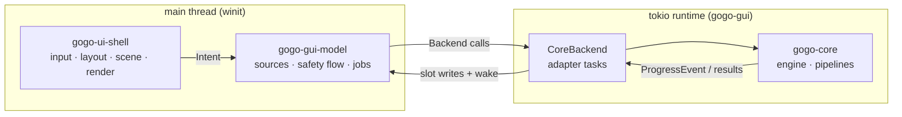
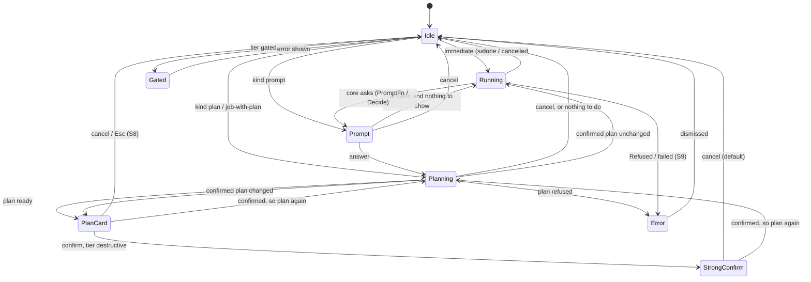

# 25 — Desktop GUI: the app layer (#520)

Status: **accepted** (2026-11-25). The model (`gogo-gui-model`, PR D1 in design 24 §8) is
built, and so is per-job cancellation in core (PR D2, §5). The core adapter is built in part
(§7, "As built").
This doc covers how the GUI talks to `gogo-core`: threads, the `Backend` seam, how live
data reaches a skin without flooding it, the safety flow, and long-running jobs. The crates are in design 24 §2. The
contract the model implements (sources, actions, kinds, tiers, invariants) is
design 26, and the skin format design 27 (both added in #557).

## 1. Threads and runtime



1. **winit owns the main thread.** macOS requires it, and winit 0.30 wants it everywhere.
   - Input, binding, layout, scene building and rendering run there.
   - So does the model's state, so the model needs no locks of its own beyond the slots (§3).
2. **`gogo-gui` starts a tokio multi-thread runtime before the event loop.** The features
   are the workspace's (`rt-multi-thread`, `macros`, `signal`, `fs`, `io-util`, `time`) plus `sync` (for
   `watch` and `oneshot`). gogo-core's async APIs run there unchanged.
3. **Synchronous pipelines run under `tokio::task::spawn_blocking`.** They don't share
   one callback type; the adapter maps each into the job's slot (§3):

   | Pipeline | Callback | Adapter |
   |---|---|---|
   | `linuxapp::build::{plan, execute}`, `macapp::{plan, execute}`, `linuxapp::setup::*`, `linuxapp::snapshots::{before_change, protect}` | `emit: &mut dyn FnMut(&ProgressEvent)` | the same fold as the broadcast events, including the `Work*` step events |
   | `linuxapp::convert` (subvolume conversion) | `emit: &mut dyn FnMut(ConvertProgress)` (`Copying`/`Verifying {done, total}`) | one step with a byte fraction |
   | `macapp::relocate::move_game` | `emit: &mut dyn FnMut(&MoveEvent)` (`Copying`/`Verifying {done, total}`) | one step with a byte fraction |
   | `linuxapp::snapshots::make_dir` | `warn: &mut dyn FnMut(String)` | a warning line on the job |
   | `linuxapp::doctor::doctor` | none: returns a `Report` | no progress; the job shows a busy step until it returns |
4. **`gogo-gui-model` has no runtime.** `Backend` methods are synchronous and return
   at once. `CoreBackend` in the binary does the spawning. The model and the safety flow
   are tested with plain `#[test]`s and a `FakeBackend`.

## 2. The `Backend` seam

`Backend` is the only thing the model knows about an engine. It's shaped after the contract,
not after gogo-core:

```rust
pub trait Backend {
    /// Start feeding a source; values arrive through the slot (§3).
    fn subscribe(&mut self, key: &SourceKey, slot: Slot) -> Subscription;
    /// The settings that gate actions, as they are now.
    fn gates(&self) -> Gates;
    fn rate_limit(&self) -> Option<u64>;
    /// Pure planning: computes, changes nothing (design 26 §4). The plan arrives later.
    fn plan(&mut self, call: &Call, answer: Option<&PromptAnswer>, reply: PlanReply);
    /// What a `prompt` action asks.
    fn prompt_for(&mut self, call: &Call) -> Result<PromptSpec, ErrorView>;
    /// Run an immediate action, or a confirmed plan, adding a job for what reports back.
    fn run(&mut self, run: Run, jobs: &mut Jobs<'_>) -> Result<(), ErrorView>;
}

/// Given with each job; `cancel`, `pause`, `resume` and `retry` act on that job alone.
pub trait JobControl: Send { /* … */ }
```

- **`Call` and `Run`.** `Call` is the model's own checked form of an action call. A `Run`
  can only be made by the safety flow, so nothing else reaches `Backend::run`.
- **`Planned`** is the `Plan` the card shows, its `PlanFacts`, a digest of the inputs it
  was computed from, and an opaque handle. A `Run` carries the handle, and the backend
  runs that plan without planning again.
- **`PlanFacts::changes`** means there is something to show on a plan card. A setting the
  user just picked is not a change by itself.

- **`CoreBackend`** maps each source to gogo-core reads:
  - `library` → `gog::library::list_games` plus `state` records;
  - `game(id)` → catalog plus state;
  - `queue` → the job table.

  Each `plan` action maps to the core's pure `plan()` function. That pattern already exists:
  `engine::plan`, `linuxapp::build::plan` ("downloads nothing"), `cloud::status::plan`.
  Running a plan maps to the matching `execute()`.
- **`FakeBackend`** (in `gogo-gui-model`, behind the `fake` feature) answers what a test
  scripts and records what it is asked. It is not in the testkit, which is dev-only
  (design 24 §2.1), so `gogo-gui --render-png` and skin dev mode (§8) can use it too.
  `FakeBackend::with_fixture()` answers sources with the fictional data of its `fixture`
  module (cover art included), which the testkit's `FixtureScope` shares.

## 3. Sources, coalescing and wakeups

**Rule: a producer overwrites; it never queues.** In the prototype, lavapipe frames fell
seconds behind a 10 Hz progress feed because every update queued a frame (design 24 §6).

- **One slot per source key.** A source key is a source name plus its parameters
  (`game(<id>)`). The slot is a latest-value cell: a value and a generation counter.
  Writers replace the value and bump the generation.
- **At most one wake per frame.** Each write sets a shared `AtomicBool dirty`, and only on
  the false → true edge calls `EventLoopProxy::send_event(Wake)`. The main thread clears the
  flag, reads every slot whose generation moved, re-binds the affected routes and draws
  once.
- **Only a changed value counts.** A slot written with the value it already had wakes the
  main thread, which then draws nothing (design 28 §6).
- **Frame pacing is the shell's.** Changes that only touch progress are drawn at most
  10 times a second per source (design 26 §3.4). Input-driven changes are drawn at once.
- **Download progress** comes from one adapter task per job. The two download lanes
  report differently:
  - **Offline installers** (`engine::execute`) broadcast `ProgressEvent`s on `ctx.events`.
    The task subscribes and folds them into a `Job` value: bytes, total, rate, ETA, files
    and steps.
  - **Depot downloads** (`gog::depot::run`) send `DepotEvent`s (`gog/depot.rs`) on an
    `mpsc::UnboundedSender` the caller passes in. The task owns the receiver and folds them
    into the same `Job` shape. An unbounded channel queues, so the fold must keep up; it
    only updates numbers, and the slot write keeps only the newest value.
  - It writes the job's slot after each event.
  - On `RecvError::Lagged` it carries on. `ChunkDone.file_bytes` is cumulative (01 §4), so
    any later event re-syncs it.
  - Rate and ETA are smoothed over a short window in the adapter. Skins get numbers, never
    pre-formatted strings.
- **Re-binding cost.** Templates are parsed once at load (design 27 §9), so a re-bind only
  evaluates. If that ever shows up in a profile, progress nodes are marked in the IR
  (design 27 §5.6) and can be patched without a full bind.
- **How the app binds.** To draw the window it calls `bind_with_fallback("shell", …)` on
  the active skin with a `Binding`:
  - `scope`: the model's read side, an `expr::Scope` that `gogo-gui` wraps round the model
    (the model can't see `gogo-skin`) and that answers the sources
    (`game($id)`, `queue.summary`, `route`, …), the route's parameters (`$id`) and `now`
    from the slots above. The binder adds its own variables, the `ui` source and the
    tokens, and asks the scope for the rest;
  - `ui`: the active skin's `UiState`, which the model restores from disk (§9) and changes
    only on `ui.set` from user input;
  - `mode`: the token set to draw with;
  - `default`: the default skin and its own `UiState`, for fallback and for `use default`.

  What it gets back is a `Bound`: the tree for the engine, an `ActionTable` the shell
  reads when the engine reports an `ActionRef` (the spec, and each argument evaluated; an
  argument that reads a toggle's `on` or a select's `value` is a `PendingArg` the model
  evaluates with the input), the app widgets to fill in, and the routes that fell back.

## 4. The safety flow

The safety flow lives in `gogo-gui-model` (`SafetyFlow`), between the dispatcher and the
backend.

- A skin's only way to cause anything is an `Intent::Invoke` (the control, its
  `ActionRef`, the control's input and an `InputProvenance`).
- `gogo-ui-interact` creates one only for a real pointer, key or AccessKit activation on a
  node whose binding names the action. It creates at most one per input event (S4). See
  "Input" below.
- `gogo-gui` turns it into the model's `Invocation` and `InputEvent`. The model takes each
  event once, checks the action and every argument against `gogo-contract` again, and goes
  through the states below.
- **Which actions are planned:** every planning or prompt kind, the actions whose
  escalation depends on the plan (`runner.set_runtime`, `runner.set_galaxy`,
  `snapshot.set_auto`), and anything not on the model's short list of immediate, safe
  actions that run directly.
- App-owned widgets are built as IR by the app, not by the skin. They are styled by the
  skin's tokens and part styles, and drawn on top of the skin's tree (S7).



| Invariant (design 26 §7) | Enforced in | Proven by |
|---|---|---|
| S4 actions only from input | `gogo-ui-interact` creates provenance; the model takes each input event once | interact test: load, hover, focus and timers fire nothing; model test: one action per event |
| S5 every plan shows first | `SafetyFlow` runs a plan only on `confirm`, which the shell calls from the app-drawn (`DrawnBy::App`) control; an `Invocation` can't express it | model tests: a skin button leads to `PlanCard`, never `Running`; a confirmation can't be skipped, replayed or aimed at another plan |
| S6 strong confirmation | `StrongConfirm` state; the default answer is no | model test per destructive action |
| S8 cancel always there | every dialog state has a cancel edge that changes nothing | model test: cancel from each state leaves the backend untouched |
| S9 uniform errors | every `Refused`/failure becomes an `ErrorView` in the app's `error` widget | model test |
| S19 global keys | `gogo-ui-interact` routes the palette key, Esc and the plan card's Enter before any skin shortcut; the model's `dismiss` and `enter` consult no skin, and the palette lists only the app's own entries | interact test; model test; app test |
| S21 settings can't weaken the flow | `Call::check` refuses a key that isn't skin-settable; gates are read from the backend at invoke, after planning, at confirm, and on resume and retry | model tests |
| S1, S2, S5, S14, S21 again at bind | the binder (`gogo-skin`): a masked value is never an action argument and reads as its mask, a part that can't be hidden isn't, every control has a non-empty accessible name once its text is known, a `settings.set` key is on the skin-settable list | binding tests over the fixture scope, with the invariant named |
| S22 input reaches only what is seen | `gogo-ui-interact`: hit-testing the clipped frame, the seen rule for keys and shortcuts, a scroll cancelling presses | interaction tests over scrolled frames |
| S1–S3 nothing secret or path-like in sources or args | `CoreBackend` builds sources from typed views; action params have no path/URL/shell types | S1 test over a fixture account with known secret strings |

### Input (`gogo-ui-interact`)

The shell feeds platform-neutral input and the layers on screen (the page, then dialogs and
toasts, each a tree and its layout); intents come out. The crate knows no gogo concept: an
app control is told apart by its `DrawnBy::App` part and tree key.

- **Provenance.** Pointer, key and AccessKit input share one counter. A press gets its
  number and time when it goes down, even if it acts on release. `InputProvenance` can only
  be made by the crate and can't be copied. The shell reports a drawn screen with the
  latest number.
- **Repeat.** A repeating key gets no number and activates nothing; it only moves focus. A
  key already down counts as repeating whether or not the platform says so. The shell does
  not forward key events the platform synthesizes on a focus change.
- **Activation.** A pointer press acts on release over the same control, Enter on the way
  down, Space on release. A press whose control changed in between (layer, key, what the
  action does, on/off state) does nothing: rows of a repeat are keyed by index, so a
  reordered list must not move a press to another game. For that the app gives each layer
  a value per action that changes when the call does, for every action; without one,
  nothing pressed on that control outlives a rebuild. A late accessibility request for a
  control that has changed is dropped the same way.
- **Global keys (S19).** Esc is a dismiss intent; Ctrl K (Cmd K on macOS) is the palette;
  neither repeats. Under a dialog a focused control takes Enter, so Enter on Cancel
  cancels; with nothing focused, Enter is the plan card's confirm. The app starts a plan
  card on nothing, and a destructive confirmation or a prompt on Cancel (the default
  answer is no).
  F12 is the skin dev mode's inspector (§8): in every run it is the app's, and like Esc
  it cancels a press under way; outside dev mode nothing else comes of it.
- **Skin shortcuts** (`key=`) work on the page only, never under a dialog, in a text field
  or on repeat. Esc, Enter, Space, Tab and the palette key are never a skin's. The first in
  document order wins.
- **Focus.** Tab walks document order over the layers that take input; the topmost dialog
  traps focus and pointer, and while it is up only it takes input: what is drawn over it
  (a toast) is shown but can't be reached, and a click on it goes nowhere. Left and Right move among the tabs of a tab list without
  activating; there is no other arrow navigation. The ring shows after the keyboard or a
  screen reader moved focus, not after a click. A route starts on nothing; a rebuild keeps
  focus by key, else the nearest earlier control; closing a dialog gives focus back.
- **Popups.** A menu, a select's list and the palette are popup layers. While one is up
  and no dialog is, only the top one takes input and is exposed to assistive technology; a
  dialog anywhere in the stack wins over it. A press outside it, on nothing or on its
  root's empty area, is a dismiss intent and presses nothing else. Esc is the same intent.
  Up and Down walk menu items and list options, stopping at the ends; in a text field over
  a list they move the app's highlight, and Enter activates the highlighted row, checked
  like any press. Focus returns to the opener when a popup closes.
- **Menus and selects.** Activating a skin `menu` button or `select` asks the app to open
  its popup; it runs no action.
- **Holds.** A hold control is held while the key is down, or the pointer is down and on
  it (also when the control moves or is covered), and never activates. A screen reader has only a discrete activation, so it takes two: the first
  arms the control, which says so; a second one at least 500 ms and at most 10 s later
  starts the 1 s hold, which completes unless it is cancelled (Esc, a focus move including
  to Cancel, any other key or button, the window losing input, the control or the dialog
  changing). The second activation is the press the model checks.
- **Scrolling.** Interaction owns the offset of each scroll container; the app lays the
  next frame out with them, and layout clamps them. Input is tested against the frame on
  the display, so an offset counts for input only once it is seen.
  - The **wheel** moves the innermost container under the pointer that can still move
    that way. A **scrollbar** thumb drags, and a press beside it turns a page.
  - **PageUp, PageDown, Home, End, Up and Down** move the containers of the focused
    control, else the page's largest one. A focused text field keeps them.
  - A **focus move** by key or screen reader brings the control into view; a pointer
    press scrolls nothing.
  - None of these is a press: they take no input number and run no action. Under a
    dialog or alert the page doesn't move.
  - **Input reaches only what is seen** (design 26 §7 S22). What is scrolled out of sight
    is clipped, so the pointer can't hit it. A scroll cancels a pending press, hold or
    arm inside the container, even when the control stays under the pointer. A control is
    *seen* when its centre is in view, and an app-drawn one only when all of it is.
    Enter or Space on a focused control that isn't seen brings it back and does nothing
    else; a running hold ends; a `key=` shortcut doesn't fire.
  - A **screen reader** can activate what it read even out of sight, which brings it into
    view; a hold control it first only brings into view, and arms once seen.
  - Offsets last for the session, per route and parameters for what holds the `outlet`
    or sits in it.
  - **Virtualised lists** (design 27 §5.4): the app binds each with the rows the last
    layout showed, checks them against the new one and binds again after a jump. Tab
    stops before items that aren't bound and scrolls on; the next press goes further.
- **Setting a text field** through AccessKit (its value, its selection or the selected
  text) is not a press and answers nothing.
- **Text fields** the app draws take input only while focused, as edit intents: the
  platform's text for the key (case kept, dead keys composed, nothing under Ctrl or Meta),
  motion by character, word and line end with Shift to select, Backspace and Delete (a
  word with Ctrl, Option on macOS), select all, undo and redo, and click, double click
  (word), triple click (all), Shift click and drag. Cmd Left and Right are the line ends
  on macOS. None is a press. **Copy and cut are presses** (only a real, non-repeating key
  writes the clipboard; no dwell); paste keeps its dwell rule. Up and Down are left alone.
  Enter and Space never activate a field. On a layout whose letters are not Latin, the
  A, C, V, X, Y and Z keys are read by their place while Ctrl or Meta is held.
- **Input methods.** One is allowed only while a field has focus, and its candidate window
  is placed at the caret. A composition is shown underlined and is not part of the text:
  a confirmation sees only what was committed. While composing, keys do nothing in the
  app (Esc and Enter included); a pointer press, a focus move or an edit by assistive
  technology drops the composition. A commit is not a press.
- **The field itself** is one line with a solid caret, which moves its text left as far as
  needed. Undo is per screen, up to 100 steps, typing a word at a time. A secret never
  goes into a field: the sign-in dialog stays paste only, with nothing to copy or undo.
- **Screen readers (`gogo-ui-a11y`).** The AccessKit tree comes from the same layers.
  Click, focus, set-value and text-selection requests become interact input, so they are
  numbered and checked like any press. Under a dialog only the dialog is exposed, as a
  modal dialog or alert named by its root, which also has focus while no control does. A scroll container is a scroll view that clips its
  children and says where it is; it takes scroll up, down and to an offset, and everything
  inside it takes scroll into view. A
  node's id covers what its action does, so a late request for a control that has since
  changed reaches nothing, even before the next tree update. A hold control's description
  says how to confirm.

### Answers

- **What an answer needs.** Each screen has a new ticket, and the shell reports when it
  has drawn it, with the time on a monotonic clock. A `Press` answers it only if all of
  these hold, so a double click or a repeating Enter can't confirm a plan that appeared
  between its two halves:
  - it **began** after the screen was presented (the shell numbers a press when it goes
    down, not when it is released), and after every input the model has already used;
  - it is not a key repeat;
  - the screen had been up for at least 500 ms when it began.

  This covers every screen that is answered: plan cards (modal and inline), the strong
  confirmation and prompts. Cancel and Esc need none of it, except on an **error alert**:
  closing one (Close, Esc, Enter on Close) takes the same press. An error can appear
  between the two halves of a double Enter or Esc (a confirmation that is then refused, an
  error queued behind a dialog), and the second half would dismiss it unread (S9).
- **The plan the user confirmed is the plan that runs.** Confirming (after the strong
  confirmation, if the tier asks for one) re-plans and compares the plan, its facts, tier
  and input digest. Any difference shows the new plan, which needs confirming again; an
  empty plan runs nothing. A `plan.preview` placed inline by a skin is read-only until
  confirmed the same way.
- **Strong confirmation.** Removing, moving, updating, DLC removal and snapshot actions on
  one game ask for its title to be typed; other destructive actions, and a plan without a
  title, ask for a 1 s hold. Enter on a destructive plan card only moves on to it. The
  typed title must match exactly once outer spaces are trimmed, with no case folding and
  no Unicode normalisation: a title that can't be typed as stored can't be confirmed,
  which fails closed, and cancel is always there.
- **One screen at a time.** Behind a dialog or an error, skins can only pause or cancel a
  job; anything else is ignored before it is even checked, so a skin can't queue up errors.
  An error identical to the one before it is not repeated. A job's questions wait their
  turn, in the order they were asked, and so do later errors.
- **Nothing runs without a card unless it is safe.** A path that would run with no plan
  card refuses any tier but safe.
- **Batches.** For `updates.apply_all` the plan's facts are the OR over its games, so one
  game that loses DLC or downgrades makes the batch destructive.
- **Previews are bounded.** The model keeps 16 and waits for at most 4 plans at once. It
  never drops a preview that is still planning or was asked for since the frame before;
  past the limit a new one is refused, so a page with too many doesn't plan them all on
  every frame.
- **Prompts from core pipelines.**
  - The core asks through `PromptFn` (`macapp::prompt`) and the cloud-save `Decide` trait.
  - `CoreBackend` implements both. It blocks the worker thread on a `oneshot`, and the model
    enters `Prompt`.
  - The prompt is drawn with the same app-owned `prompt`/`picker`/`saves-conflicts`
    widgets as a skin-started prompt.
  - Cancel answers `None` or `Confirm::No`, and the pipeline stops without changes (S8).
  - **Linux build and set-up ask before the confirm** (PR F4, #537). The core pipelines
    store each answer as soon as they get it, so the GUI doesn't ask through them:
    `linuxapp::preview` asks the same questions in the same order and writes nothing. The
    answers stay in memory until the user confirms, then go to the pipeline.
- **Planning can ask.** A backend that can't plan without an answer replies with a
  question instead of a plan (`PlanReply::ask`). The app asks it, then plans the same call
  again with every answer so far; the check after a confirmation reuses them. Cancel drops
  the request, so nothing may be written or stored before the confirm.
- **Jobs that can't be stopped.** A job can report that it can't be stopped now. The app
  then refuses `job.cancel` and `job.pause` for it, and refuses to close its window with
  its own notice until the step ends.
- **Secret input** (the sign-in code, revealing or editing an env value) stays inside
  depth-A app widgets. The value goes straight to the core and never enters a source or the
  binding scope (S1, S2).

- **The free space is not part of the comparison.** A plan can show how much room there is
  (`Plan.free`). It moves on its own, so a plan that differs only there is still the plan
  the user saw.
- **A job whose plan changed asks on the plan card.** A resumed or retried job plans again
  itself; if the new plan holds anything the confirmed one didn't, the job asks with
  `PromptSpec::Plan`. The model shows it as a plan card with the same present, dwell and
  fresh-press rules, and answers the job's reply from its confirm control or Enter. The job
  holds the plan it showed, so nothing is planned again. Esc, Cancel, `job.cancel` and
  `job.pause` answer with a cancel. The action's gate is checked again at that confirm.
  Jobs that remove data get no such card.

### As built: the safety screens (#614)

Every screen of the safety flow is the app's own modal layer, one per ticket, and the app
cancels none of them: only the user does. Fixed colours (#640).

| Screen | Layer | Shows | Starts on |
|---|---|---|---|
| Planning | dialog | "Working out what to do…", Cancel | nothing |
| Plan card | dialog | title, subject, steps, totals, warnings, whether it can be undone, "Nothing changes until you confirm.", Cancel and the plan's verb; says when the plan changed | nothing |
| Typed confirmation | alert | the plan, the title to type, a one-line field; the verb is disabled until the trimmed text is the title | Cancel |
| Hold confirmation | alert | the plan, a hold button, how far the hold is and its state | Cancel |
| Prompt | dialog | yes or no (No, Yes); one button per choice; a field and OK; the paste-only secret form; per conflicting file the two copies, and Apply once all are decided | Cancel |
| Error | alert | the class word, title, message, hint, Close | Close |

- **Presented.** `Model::presented` is called from the shell's presented report, so only for
  a frame that reached the display (GPU or CPU), and only for a dialog that shows all of
  itself.
- **Only what is on the display takes input.** A screen the model has that is not presented
  yet takes nothing, Esc included. A wake or a pump that brings up another screen asks for
  a frame even when no source changed.
- **Holds.** Interaction ending a hold on its own (its control moved, was covered or
  changed with a new frame) stops the model's hold. A hold completes only up to the time
  of the frame before the one just presented, so that a release that came during a slow
  frame is heard first.
- **Nothing scrolls.** A long list (steps, options, conflicting files) is paged; warnings,
  totals, the footnote and the buttons are on every page. Confirming does not ask for
  every page to have been turned to. When the rest alone does not fit the window, the
  dialog says to enlarge it, its confirm is disabled and the model is not told it was
  presented.
- **A dialog that can't be built** stays pending: a panel says so, nothing can answer it,
  and Esc cancels it. If the panel can't be built either, an empty layer made at startup
  takes its place, so that Esc still has something to reach.
- **An error too large for the window** starts its wait all the same, so it can be closed.
- **The typed title** can be typed, pasted (first line) or set through AccessKit. A title
  holding characters the user's keyboard can't type needs one of the last two, or can't
  be confirmed.
- **Not drawn yet:** inline `plan-card` previews, so a skin's slot for one stays empty;
  toasts, so a confirmed plan that turned out empty closes without a word.

### As built: popups (#546)

- A skin `menu` or `select` opens the app's popup by the control, from the items and
  options the binder kept, in fixed colours (#640). It is below the control, or above when
  only that fits, and kept inside the window.
- It starts on the menu's first item or the select's current option. Choosing closes it
  and runs the control's call through the same `Model::invoke` as a button, so the same
  checks, plan card and confirmation apply. A press opens, another chooses (S4).
- **A safety screen or a panel always wins.** The page, then the popup, then the panel or
  dialog: a modal ticket or a panel closes the popup, and it does not come back.
- It also closes on Esc, a press outside, a route change, a skin reload, a window resize,
  and when its control is gone or came to list something else.
- Between opening and presentation, and between closing and the next frame, input does
  nothing, but for Esc closing a popup that is opening.
- Popups don't scroll yet: a long list shows a window of rows that follows focus, with a
  button at an end that has more. It stays in the window: where there is no room beside
  the control it covers it.
- On real data the Default skin's "Open game folder" answers "unavailable", and its
  renderer, runtime and display-mode selects are empty, until the backend runs those
  actions (#703).

**The command palette.** Ctrl K (Cmd K on macOS) or a `palette.open` control opens it
over any route; Ctrl K or Esc closes it. Under a safety screen or a panel it does not
open.

- **The app alone builds the entries**, from its own table and the app's data. It reads
  nothing of the skin.
- **Entries:** on a game page, downloading its files, installing it when it is not
  installed, and setting it up (the last two on Linux); refreshing the library; signing in
  when signed out; going to each route that needs no parameter; going to each game of the
  library. Only what the engine can run today, and nothing gated or destructive.
- **Choosing** an entry closes the palette and calls `Model::invoke` with that press, so
  the plan card and confirmation apply as for a button.
- **Search** is case-insensitive over the labels; entries where it starts a word come
  first. The field is the app's own and edits like a dialog's (#544): caret and selection,
  clipboard, undo, input methods and assistive technology. A composition is not searched
  for until it is committed.
- **Keys:** focus stays in the field; Up and Down move the highlight and Enter chooses it.
  A press made before the list it answers was on the display does nothing.
- `palette.open`'s `scope` is not used yet.

## 5. Jobs, progress and cancellation

- **A strong confirmation covers one run.** `job.retry` and `job.resume` of a failed or
  cancelled destructive job are refused: the action is started again and plans afresh. A
  paused job carries on.
- **A restart never hides an end.** `job.retry` and `job.resume` are refused until the
  model has taken the job's current state, so a failure is always reported first (S9).
- **The table is bounded.** It keeps the newest 64 ended jobs; live ones are never dropped.
- **The job table.** `JobTable` in the model holds one entry per long-running action:
  - an id and the action;
  - a state: `queued`, `running`, `paused`, `failed`, `done` or `cancelled`;
  - a progress slot, where a terminal state is final until a resume or retry;
  - a control handle (cancel, pause, resume, retry).

  It feeds the `queue`, `queue.summary` and `job(id)` sources (design 26 §3.4).
- **Steps.** Install pipelines report `WorkStarted/WorkProgress/WorkDone` and their step
  events. These map onto `Job.steps`, drawn by the stock `step-list` component or by a
  skin's own rebuild.
- **Toasts** fire on start, finish and failure only.
- **Per-job cancellation (PR D2, #532).** `ctx.job()` makes a `JobScope`: a child of
  `AppContext.cancel` and an event channel of its own. Cancelling the child stops that job
  alone; cancelling the app token still stops them all.
  - **Installer downloads** run with `engine::execute_job(ctx, &scope, tasks)`. `Done` and
    `Warn` carry no job id, which is why each job has its own channel. `engine::plan` still
    reports on `ctx.events`.
  - **Depot downloads** pass `scope.cancel_token()` to `depot::run`.
  - **DLC add, remove and update** bind it to their `stop` closure, and their fetch closure
    passes it to `depot::fetch_into`.
  - A cancel interrupts network waits, the rate limiter and backoff sleeps, and files not
    yet started leave nothing behind.
  - Builds, setup, rollback, move, runtime installs and cloud saves take no token yet (#652).
  - The CLI calls `execute`, which uses `ctx.cancel` and `ctx.events` as before.
- **What `CoreBackend` must do.**
  - Build one `AppContext` and share it: two would each save their own copy of the install
    records over the other's.
  - Give it the core's own client (`gog::http()`). A client with a total request timeout
    cuts long downloads off.
  - Always stop a job by its token, never by dropping or aborting its future: file tasks
    and chunk workers are spawned on their own and would write on after the file lock is
    released.
  - A token stays cancelled: resume and retry take a new job and plan again.
  - Run jobs that write the same files (one product's depot cache, a runtime install) one
    at a time; nothing in core locks them against each other (#653). The depot rate
    limit is per download, not shared (#656).
- **Cancel leaves resumable state**, as Ctrl C does in the CLI: sidecars stay (04 §4), and
  the job shows `cancelled` with a resume action.

As built (PR F3, downloads, `core/download/`):

- **Lane.** `game.download` uses the offline installers only. Depot downloads come with the
  install flows.
- **Selection.** `selection` is optional. Without it: installers for this system
  (`gog.platform`), in the configured language, no extras and no DLC; a game with none
  for this system gets the Windows installers, with a warning.
- **Planning** reads the product (and the owned ids, for DLC) and local files. It resolves
  no link, fetches no checksum and creates nothing, so sizes are GOG's listing figures and
  file names appear when the download starts. The card shows the folder, what is missing of
  each file, what is already there, DLC left out and the free space. Too little space
  refuses the plan (class Disk); what other live downloads still need counts against it.
  A product with a queued, running or paused download is refused a second one.
- **Running.** One `AppContext`, made at the first plan, on `gog::http()`; its token
  provider takes the app's refresh lock. A job runs exactly the confirmed files; files that
  arrived since are left out and nothing is added.
- **Turns.** Two jobs download at once, first come first served, and never two of one
  product. The others show `queued`.
- **Progress** is folded from the job's events, latest value wins, and reported at most
  every 100 ms, all jobs on the same ticks. The rate is over the last 5 s; there is no ETA
  without a rate.
- **Cancel and pause** only cancel the job's token and show the state at once. Core has no
  true pause: both keep the `.part` and sidecars, and a resume fetches the checksum again
  and loses the chunks that were in flight.
- **Resume and retry** take a new scope and plan again. The same files or fewer run
  without a card; anything added or changed is shown on the job's plan card (§4), and
  saying no puts the job back to paused or cancelled.
- **Rate limit.** `queue.set_rate_limit` changes the one limiter every download shares, for
  this session.
- **Errors** are a fixed phrase per exit class and the file's name. A file held by another
  gogo fails the job.
- **Closing the app** cancels every job's token and waits up to 5 s for the files to be
  closed.
- **Not done:** the queue's Repair button (`game.verify_fix`), a "downloads are running"
  question on close, stopping cleanly on a signal, game status badges while downloading,
  and keeping the queue across restarts (the sidecars stay, so a new download resumes).

As built (PR F4, install flows, `core/install/`):

- **Platform.** Linux only. macOS build and set-up from the GUI are issue #676; there the
  actions answer "not available".
- **Questions.** `game.setup` plans through `linuxapp::preview`, which asks the questions
  the pipeline would ask (umu, where GE-Proton goes, Galaxy, installing Comet) and writes
  nothing. The run stores the answers, then calls `linuxapp::setup::setup`; the only
  question still open there is Galaxy's, answered from memory. A running job never asks.
- **Card.** Verb "Run setup", tier confirm: the downloads and where they go, the runtime
  and umu, the prefix (created or kept), the snapshot before a runtime change, the
  choices that will be saved, and the free space. Downloads larger than the free space
  are refused.
- **Jobs.** Kind `setup`. One install at a time, and never beside a download of the same
  game; an install takes no download slot. Once the pipeline runs the job is not
  stoppable (#652), so closing the window is refused. A waiting job can be cancelled or
  paused; resume and retry preview again, ask on the plan card if the run would do more,
  and fail if it would need a new answer.
- **Steps.** The phases the plan expects are listed up front and moved by the pipeline's
  events, under the app's own names: event texts can hold paths. Silent phases show no
  fraction.
- **Errors.** Fixed phrases per class. The core's text goes to the log only.
- **Build: source.** `game.build` takes `linux-app`'s source order (`gog::lane`): the depot
  cache, a repair of it, a depot download, else a downloaded offline installer.
  `linuxapp::source` resolves it and writes nothing.
- **Build: DLC and defaults.** An omitted `dlc` takes every owned DLC of the build; a
  rebuild keeps the recorded set, and refuses a build that lacks one. An omitted runtime,
  renderer, language or build id takes the CLI's default. There is no picker. A given
  `runtime` must be a catalog id: `path:` is refused. From an
  offline installer no DLC installers are run, and the card says which are left out.
- **Build: the launcher's `gogo`.** The `gogo` beside the app, else the first on `PATH`,
  else the plan is refused. The card shows the path: the game's launcher calls it.
- **Build: job.** The game files download first, in a cancellable step; a cancel leaves
  the resumable cache. That download takes none of the two download slots, so it can be a
  third download running, and it has a rate limiter of its own at the queue's limit
  (#656). From there the job is not stoppable. Answers are stored after the
  download, just before the pipeline runs.
- **Not done.** Setup's warnings and notes have nowhere to show, and there is no skin
  button for a rebuild.

## 6. Errors

- Every failure reaches the model as an `ErrorView {class, title, message, hint, exit_class}`.
  It is built from the core's thiserror enums, which are already redacted at construction
  (07 §4).
- The class word (Network, Disk, Auth, …) is the same one the CLI uses for its exit
  classes (07 §2).
- Skins may draw their own error states from an action's `last_error`, but the app's
  `error` widget is always shown as well (S9).

## 7. Images

- Cover art is fetched by `CoreBackend` and decoded off the main thread with `image`
  (`jpeg` and `webp` only), with dimension and byte limits. Decoding runs inside
  `catch_unwind`, since decoders can panic on hostile input.
- The decoded image reaches the scene as an `ImageId`, and skins never see a URL (S3).
- The GPU renderer uploads it into a texture cache with a byte budget (design 28 §4).

As built (PR F1, `CoreBackend`, read-only):

- **Sources read:** `account`, `app`, `library` (its filter and sort arguments are not
  applied yet), `library.stats`, `game`, `game.builds`, `game.dlc`, `game.files`. Every
  other source gets a well-shaped empty value, so no screen waits for ever.
- **Loading.** While a source the route reads has no value, an app-owned "Loading" layer
  is over the last screen; only Esc acts. A read that fails still writes an empty value.
- **Failures** that no call waits for go through `Failures`, which the model hands the
  backend in `Backend::attach` and turns into error screens.
- **Covers** are asked for by the renderers (a handle `art:<id>:cover` or
  `:background`), so only drawn ones are fetched: the address comes from the product's
  public page (`GET /v2/games/{id}`, no credential), https and GOG's image hosts only,
  redirects included; body at most 8 MiB, at most 4096 px a side and 16 MP checked
  before decoding, an allocation limit, `catch_unwind`; shrunk to about twice the drawn
  size, 128 MiB in memory (least recently asked for goes first), and kept as JPEG under
  the cover cache (§9), named by a hash of its address, so a changed picture is fetched
  again; offline, whatever is kept is shown. The logo is a PNG, so it has no picture.
- **Description** HTML becomes plain text without addresses.
- F1 read only. Besides `library.refresh`, `account.sign_in`, `game.download` and
  `queue.set_rate_limit`, plans and runs are refused.

As built (PR F2, sign-in):

- **Flow.** `prompt_for(account.sign_in)` opens GOG's page (`xdg-open` / `open`; the
  address is shown only if that fails) and asks for a secret. A token store that could
  not keep the result refuses before the browser opens. The plan has nothing to show, so
  the answer runs it at once; the exchange runs on the runtime under an app-owned
  "Signing in…" layer, and a failure comes back through `Failures`. Success reads every
  source again.
- **The dialog** is the app's own layer: Paste, Clear, Open the page again, Sign in,
  Cancel (initial focus). Paste only (also the primary modifier and V). The clipboard is
  read only for a press made after the dialog had been up for the dwell time; the shell
  reads it and hands the app at most 4 KiB. That cap is applied after the library has
  read the whole clipboard, the libraries' own copies are not wiped, and the clipboard
  is deliberately left as it is after a paste. The press must also be a fresh one, as
  for any answer. The app keeps the parsed code, never the
  pasted text, and the screen and assistive technology are told only whether a code is
  there. Fixed colours: skin tokens are a follow-up.
- **Error screens** (S9) are drawn the same way, with Close. The other safety screens
  came with #614 (§4).
- **Secrets in memory.** The model's `Secret` and the copies the app makes are wiped on
  drop; gogo-core and gog-warp take the code as an ordinary string.

## 8. Skin dev mode

- **`gogo-gui --dev <skin dir>`:**
  - watches the skin folder (notify) and re-loads it on change;
  - shows validator diagnostics in an app-owned panel;
  - adds an inspector that shows each node's bindings and their current values.
- **Data.** Dev mode runs on `CoreBackend`, or on fixture data with `--fixture`.
- **`gogo-gui --check-skin <dir>`** validates without a window, for skin authors and CI.
  Exit 0: no errors (warnings allowed); 1: a skin or route error; 2: bad usage.
- **`gogo-gui --render-png <out> [--route R] [--scale N] [--skin <dir>]`** draws a route on
  fixture data without a window, on vello_cpu, at 960×600 logical px (the golden images).

As built (PR E4):

- `--fixture` and `--render-png` need the binary's `fixture` feature, which a normal
  build leaves off with all the fictional data. Without `--fixture` the window runs on
  `CoreBackend` (PR F1).
- A reload takes the new skin only if it loads with no errors and its routes bind.
  Otherwise the last good skin stays, and the errors are listed over it. App-widget
  content is not built yet.
- In fixture mode the queue a skin shows is the fixture's: the model's job table is empty
  without an engine.
- A skin's own asset files are not decoded yet.

As built (input and AccessKit wiring):

- The shell translates winit events into `gogo-ui-interact`'s input and times them on one
  monotonic clock. `gogo-gui` owns the `Interaction` and the `A11yTree` and resolves an
  `ActionRef` against the screen the press was on.
- `ui.set` writes the skin's value; a reload keeps it where the new skin still has it.
- A frame is built as pending and becomes the one input and assistive technology act on
  only when the shell reports it presented; a skipped or failed frame changes nothing.
- The safety flow's screens are drawn as §4 "As built" says (#614).
- The error panel is an alert layer: while it is up only Esc does anything, nothing under
  it can be pressed, and assistive technology reads its lines. A route that no skin draws
  leaves the last screen in sight under it.
- Touch and the account menu are not wired in; the clipboard is read only by a paste (in a
  dialog or the palette's field) and written only by copy or cut in a text field.

As built: the inspector (G5, #548):

- **Gating.** F12 opens and closes it, only with `--dev`; it starts closed. Without
  `--dev` it opens nothing and no bind records anything. In every run `Interaction` takes
  the key as the app's and cancels a press under way, as it does for Esc and the palette
  key; one press toggles once, whatever it repeats. A skin's `key=` names single
  characters only, so no skin can take F12.
- **Placement.** An app-drawn layer docked on the right, 360 px wide and never more than
  half the window. The page is laid out in the width that is left, so the panel covers no
  control and S22 needs no rule of its own. Fixed colours; a skin can't style, hide or
  open it.
- **Content.** The selected node's key and box; what a traced bind recorded of it
  (design 27 §9.1): file and line, what is around it, `style=`, each expression with its
  current value, the names in scope, the action with its arguments, and the children left
  out; then its parents and children as buttons that select them.
- **Picking.** "Pick a node" makes the panel take all input, as a popup does: the page
  gets no press, key, shortcut, wheel or screen reader action, so a pick can't run what
  it picks. An outline follows the pointer, a click selects the element under it, and Esc
  stops. Scroll something into view before picking it. A popup, the error panel or a
  safety screen ends picking. Outside picking, the selected node is outlined. A frame is
  asked for only when the node under the pointer changes.
- **Safety.** It reads the page's bind only: no dialog, no typed text, no app widget's
  content. It is below the popup, the error panel and the safety screens, and takes no
  input while any of them is up. Its presses are numbered by `Interaction` like any
  other, and run no action. What it shows is never written to stdout, the log or a file;
  stdout says the selected node's key and file and line. With real data, the screen can
  show what the skin can: the account's name and paths, say, in a screenshot.

## 9. Where things are stored

Paths follow 06 §1 (the `dirs` crate), which lists these rows too. With `GOGO_HOME` set,
they move under it like everything else: `$GOGO_HOME/skins/`, `$GOGO_HOME/gui/` (state)
and `$GOGO_HOME/gui-cache/` (cache), so state and cache stay apart.

| What | Linux | macOS |
|---|---|---|
| Installed skins | `$XDG_DATA_HOME/gogo/skins/<name>/` | `~/Library/Application Support/gogo/skins/<name>/` |
| Per-skin UI state (design 26 §6.4) and the active skin | `$XDG_STATE_HOME/gogo/gui/` | `~/Library/Application Support/gogo/gui/` |
| Pipeline cache, decoded covers | `$XDG_CACHE_HOME/gogo/gui/` | `~/Library/Caches/gogo/gui/` |

- Built-in skins are not in the skin folder: they are embedded (`gogo-skins`, design 24 §2)
  and load through the same loader. The Default skin is `crates/gogo-skins/skins/default/`.
- Every file is written atomically (tmp, fsync, rename) like `state.json`.
- An unreadable cache is ignored.
- Unreadable UI state falls back to the skin's declared defaults.
