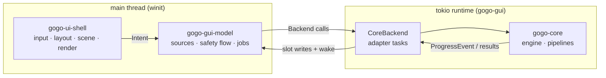
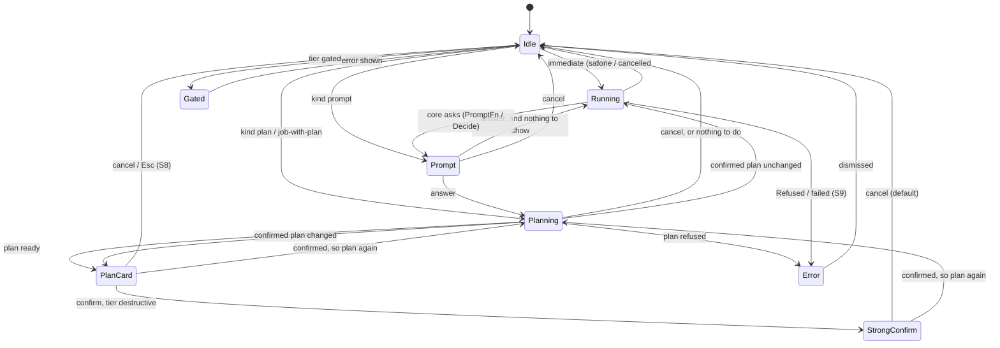

# 25 — Desktop GUI: the app layer (#520)

Status: **accepted** (2026-11-25). The model (`gogo-gui-model`, PR D1 in design 24 §8) is
built; the core adapter, the shell wiring and per-job cancellation in core (PR D2) are not.
This doc covers how the GUI talks to `gogo-core`: threads, the `Backend` seam, how live
data reaches a skin without flooding it, the safety flow, and long-running jobs. The crates are in design 24 §2. The
contract the model implements (sources, actions, kinds, tiers, invariants) is
design 26, and the skin format design 27 (both added in #557).

## 1. Threads and runtime



1. **winit owns the main thread.** macOS requires it, and winit 0.30 wants it everywhere.
   - Input, binding, layout, scene building and rendering run there.
   - So does the model's state, so the model needs no locks of its own beyond the slots (§3).
2. **`gogo-gui` starts a tokio multi-thread runtime before the event loop.** The features
   are the workspace's (`rt-multi-thread`, `macros`, `signal`, `fs`, `io-util`, `time`) plus `sync` (for
   `watch` and `oneshot`). gogo-core's async APIs run there unchanged.
3. **Synchronous pipelines run under `tokio::task::spawn_blocking`.** They don't share
   one callback type; the adapter maps each into the job's slot (§3):

   | Pipeline | Callback | Adapter |
   |---|---|---|
   | `linuxapp::build::{plan, execute}`, `macapp::{plan, execute}`, `linuxapp::setup::*`, `linuxapp::snapshots::{before_change, protect}` | `emit: &mut dyn FnMut(&ProgressEvent)` | the same fold as the broadcast events, including the `Work*` step events |
   | `linuxapp::convert` (subvolume conversion) | `emit: &mut dyn FnMut(ConvertProgress)` (`Copying`/`Verifying {done, total}`) | one step with a byte fraction |
   | `macapp::relocate::move_game` | `emit: &mut dyn FnMut(&MoveEvent)` (`Copying`/`Verifying {done, total}`) | one step with a byte fraction |
   | `linuxapp::snapshots::make_dir` | `warn: &mut dyn FnMut(String)` | a warning line on the job |
   | `linuxapp::doctor::doctor` | none: returns a `Report` | no progress; the job shows a busy step until it returns |
4. **`gogo-gui-model` has no runtime.** `Backend` methods are synchronous and return
   at once. `CoreBackend` in the binary does the spawning. The model and the safety flow
   are tested with plain `#[test]`s and a `FakeBackend`.

## 2. The `Backend` seam

`Backend` is the only thing the model knows about an engine. It's shaped after the contract,
not after gogo-core:

```rust
pub trait Backend {
    /// Start feeding a source; values arrive through the slot (§3).
    fn subscribe(&mut self, key: &SourceKey, slot: Slot) -> Subscription;
    /// The settings that gate actions, as they are now.
    fn gates(&self) -> Gates;
    fn rate_limit(&self) -> Option<u64>;
    /// Pure planning: computes, changes nothing (design 26 §4). The plan arrives later.
    fn plan(&mut self, call: &Call, answer: Option<&PromptAnswer>, reply: PlanReply);
    /// What a `prompt` action asks.
    fn prompt_for(&mut self, call: &Call) -> Result<PromptSpec, ErrorView>;
    /// Run an immediate action, or a confirmed plan, adding a job for what reports back.
    fn run(&mut self, run: Run, jobs: &mut Jobs<'_>) -> Result<(), ErrorView>;
}

/// Given with each job; `cancel`, `pause`, `resume` and `retry` act on that job alone.
pub trait JobControl: Send { /* … */ }
```

- **`Call` and `Run`.** `Call` is the model's own checked form of an action call. A `Run`
  can only be made by the safety flow, so nothing else reaches `Backend::run`.
- **`Planned`** is the `Plan` the card shows, its `PlanFacts`, a digest of the inputs it
  was computed from, and an opaque handle. A `Run` carries the handle, and the backend
  runs that plan without planning again.
- **`PlanFacts::changes`** means there is something to show on a plan card. A setting the
  user just picked is not a change by itself.

- **`CoreBackend`** maps each source to gogo-core reads:
  - `library` → `gog::library::list_games` plus `state` records;
  - `game(id)` → catalog plus state;
  - `queue` → the job table.

  Each `plan` action maps to the core's pure `plan()` function. That pattern already exists:
  `engine::plan`, `linuxapp::build::plan` ("downloads nothing"), `cloud::status::plan`.
  Running a plan maps to the matching `execute()`.
- **`FakeBackend`** (in `gogo-gui-model`, behind the `fake` feature) answers what a test
  scripts and records what it is asked. It is not in the testkit, which is dev-only
  (design 24 §2.1), so `gogo-gui --render-png` and skin dev mode (§8) can use it too.

## 3. Sources, coalescing and wakeups

**Rule: a producer overwrites; it never queues.** In the prototype, lavapipe frames fell
seconds behind a 10 Hz progress feed because every update queued a frame (design 24 §6).

- **One slot per source key.** A source key is a source name plus its parameters
  (`game(<id>)`). The slot is a latest-value cell: a value and a generation counter.
  Writers replace the value and bump the generation.
- **At most one wake per frame.** Each write sets a shared `AtomicBool dirty`, and only on
  the false → true edge calls `EventLoopProxy::send_event(Wake)`. The main thread clears the
  flag, reads every slot whose generation moved, re-binds the affected routes and draws
  once.
- **Frame pacing is the shell's.** Changes that only touch progress are drawn at most
  10 times a second per source (design 26 §3.4). Input-driven changes are drawn at once.
- **Download progress** comes from one adapter task per job. The two download lanes
  report differently:
  - **Offline installers** (`engine::execute`) broadcast `ProgressEvent`s on `ctx.events`.
    The task subscribes and folds them into a `Job` value: bytes, total, rate, ETA, files
    and steps.
  - **Depot downloads** (`gog::depot::run`) send `DepotEvent`s (`gog/depot.rs`) on an
    `mpsc::UnboundedSender` the caller passes in. The task owns the receiver and folds them
    into the same `Job` shape. An unbounded channel queues, so the fold must keep up; it
    only updates numbers, and the slot write keeps only the newest value.
  - It writes the job's slot after each event.
  - On `RecvError::Lagged` it carries on. `ChunkDone.file_bytes` is cumulative (01 §4), so
    any later event re-syncs it.
  - Rate and ETA are smoothed over a short window in the adapter. Skins get numbers, never
    pre-formatted strings.
- **Re-binding cost.** Templates are parsed once at load (design 27 §9), so a re-bind only
  evaluates. If that ever shows up in a profile, progress nodes are marked in the IR
  (design 27 §5.6) and can be patched without a full bind.
- **How the app binds.** To draw the window it calls `bind_with_fallback("shell", …)` on
  the active skin with a `Binding`:
  - `scope`: the model's read side, an `expr::Scope` that `gogo-gui` wraps round the model
    (the model can't see `gogo-skin`) and that answers the sources
    (`game($id)`, `queue.summary`, `route`, …), the route's parameters (`$id`) and `now`
    from the slots above. The binder adds its own variables, the `ui` source and the
    tokens, and asks the scope for the rest;
  - `ui`: the active skin's `UiState`, which the model restores from disk (§9) and changes
    only on `ui.set` from user input;
  - `mode`: the token set to draw with;
  - `default`: the default skin and its own `UiState`, for fallback and for `use default`.

  What it gets back is a `Bound`: the tree for the engine, an `ActionTable` the shell
  reads when the engine reports an `ActionRef` (the spec, and each argument evaluated; an
  argument that reads a toggle's `on` or a select's `value` is a `PendingArg` the model
  evaluates with the input), the app widgets to fill in, and the routes that fell back.

## 4. The safety flow

The safety flow lives in `gogo-gui-model` (`SafetyFlow`), between the dispatcher and the
backend.

- A skin's only way to cause anything is an `Intent::Invoke` (the control, its
  `ActionRef`, the control's input and an `InputProvenance`).
- `gogo-ui-interact` creates one only for a real pointer, key or AccessKit activation on a
  node whose binding names the action. It creates at most one per input event (S4). See
  "Input" below.
- `gogo-gui` turns it into the model's `Invocation` and `InputEvent`. The model takes each
  event once, checks the action and every argument against `gogo-contract` again, and goes
  through the states below.
- **Which actions are planned:** every planning or prompt kind, the actions whose
  escalation depends on the plan (`runner.set_runtime`, `runner.set_galaxy`,
  `snapshot.set_auto`), and anything not on the model's short list of immediate, safe
  actions that run directly.
- App-owned widgets are built as IR by the app, not by the skin. They are styled by the
  skin's tokens and part styles, and drawn on top of the skin's tree (S7).



| Invariant (design 26 §7) | Enforced in | Proven by |
|---|---|---|
| S4 actions only from input | `gogo-ui-interact` creates provenance; the model takes each input event once | interact test: load, hover, focus and timers fire nothing; model test: one action per event |
| S5 every plan shows first | `SafetyFlow` runs a plan only on `confirm`, which the shell calls from the app-drawn (`DrawnBy::App`) control; an `Invocation` can't express it | model tests: a skin button leads to `PlanCard`, never `Running`; a confirmation can't be skipped, replayed or aimed at another plan |
| S6 strong confirmation | `StrongConfirm` state; the default answer is no | model test per destructive action |
| S8 cancel always there | every dialog state has a cancel edge that changes nothing | model test: cancel from each state leaves the backend untouched |
| S9 uniform errors | every `Refused`/failure becomes an `ErrorView` in the app's `error` widget | model test |
| S19 global keys | `gogo-ui-interact` routes the palette key, Esc and the plan card's Enter before any skin shortcut; the model's `dismiss` and `enter` consult no skin | interact test; model test |
| S21 settings can't weaken the flow | `Call::check` refuses a key that isn't skin-settable; gates are read from the backend at invoke, after planning, at confirm, and on resume and retry | model tests |
| S1, S2, S5, S14, S21 again at bind | the binder (`gogo-skin`): a masked value is never an action argument and reads as its mask, a part that can't be hidden isn't, every control has a non-empty accessible name once its text is known, a `settings.set` key is on the skin-settable list | binding tests over the fixture scope, with the invariant named |
| S1–S3 nothing secret or path-like in sources or args | `CoreBackend` builds sources from typed views; action params have no path/URL/shell types | S1 test over a fixture account with known secret strings |

### Input (`gogo-ui-interact`)

The shell feeds platform-neutral input and the layers on screen (the page, then dialogs and
toasts, each a tree and its layout); intents come out. The crate knows no gogo concept: an
app control is told apart by its `DrawnBy::App` part and tree key.

- **Provenance.** Pointer, key and AccessKit input share one counter. A press gets its
  number and time when it goes down, even if it acts on release. `InputProvenance` can only
  be made by the crate and can't be copied. The shell reports a drawn screen with the
  latest number.
- **Repeat.** A repeating key gets no number and activates nothing; it only moves focus. A
  key already down counts as repeating whether or not the platform says so. The shell does
  not forward key events the platform synthesizes on a focus change.
- **Activation.** A pointer press acts on release over the same control, Enter on the way
  down, Space on release. A press whose control changed in between (layer, key, what the
  action does, on/off state) does nothing: rows of a repeat are keyed by index, so a
  reordered list must not move a press to another game. For that the app gives each layer
  a value per action that changes when the call does, for every action; without one,
  nothing pressed on that control outlives a rebuild. A late accessibility request for a
  control that has changed is dropped the same way.
- **Global keys (S19).** Esc is a dismiss intent; Ctrl K (Cmd K on macOS) is the palette;
  neither repeats. Under a dialog a focused control takes Enter, so Enter on Cancel
  cancels; with nothing focused, Enter is the plan card's confirm. The app starts a plan
  card on nothing, and a destructive confirmation or a prompt on Cancel (the default
  answer is no).
- **Skin shortcuts** (`key=`) work on the page only, never under a dialog, in a text field
  or on repeat. Esc, Enter, Space, Tab and the palette key are never a skin's. The first in
  document order wins.
- **Focus.** Tab walks document order over the layers that take input; the topmost dialog
  traps focus and pointer, and while it is up only it takes input: what is drawn over it
  (a toast) is shown but can't be reached, and a click on it goes nowhere. Left and Right move among the tabs of a tab list without
  activating; there is no other arrow navigation. The ring shows after the keyboard or a
  screen reader moved focus, not after a click. A route starts on nothing; a rebuild keeps
  focus by key, else the nearest earlier control; closing a dialog gives focus back.
- **Holds.** A hold control is held while the key is down, or the pointer is down and on
  it (also when the control moves or is covered), and never activates. A screen reader has only a discrete activation, so it takes two: the first
  arms the control, which says so; a second one at least 500 ms and at most 10 s later
  starts the 1 s hold, which completes unless it is cancelled (Esc, a focus move including
  to Cancel, any other key or button, the window losing input, the control or the dialog
  changing). The second activation is the press the model checks.
- **Setting a text field** through AccessKit is not a press and answers nothing.
- **Screen readers (`gogo-ui-a11y`).** The AccessKit tree comes from the same layers.
  Click, focus and set-value requests become interact input, so they are numbered and
  checked like any press. Under a dialog only the dialog is exposed, as a modal dialog or
  alert named by its root, which also has focus while no control does. A node's id covers
  what its action does, so a late request for a control that has since changed reaches
  nothing, even before the next tree update. A hold control's description says how to confirm.

### Answers

- **What an answer needs.** Each screen has a new ticket, and the shell reports when it
  has drawn it, with the time on a monotonic clock. A `Press` answers it only if all of
  these hold, so a double click or a repeating Enter can't confirm a plan that appeared
  between its two halves:
  - it **began** after the screen was presented (the shell numbers a press when it goes
    down, not when it is released), and after every input the model has already used;
  - it is not a key repeat;
  - the screen had been up for at least 500 ms when it began.

  This covers every screen that is answered: plan cards (modal and inline), the strong
  confirmation and prompts. Cancel and Esc need none of it.
- **The plan the user confirmed is the plan that runs.** Confirming (after the strong
  confirmation, if the tier asks for one) re-plans and compares the plan, its facts, tier
  and input digest. Any difference shows the new plan, which needs confirming again; an
  empty plan runs nothing. A `plan.preview` placed inline by a skin is read-only until
  confirmed the same way.
- **Strong confirmation.** Removing, moving, updating, DLC removal and snapshot actions on
  one game ask for its title to be typed; other destructive actions, and a plan without a
  title, ask for a 1 s hold. Enter on a destructive plan card only moves on to it. The
  typed title must match exactly once outer spaces are trimmed, with no case folding and
  no Unicode normalisation: a title that can't be typed as stored can't be confirmed,
  which fails closed, and cancel is always there.
- **One screen at a time.** Behind a dialog or an error, skins can only pause or cancel a
  job; anything else is ignored before it is even checked, so a skin can't queue up errors.
  An error identical to the one before it is not repeated. A job's questions wait their
  turn, in the order they were asked, and so do later errors.
- **Nothing runs without a card unless it is safe.** A path that would run with no plan
  card refuses any tier but safe.
- **Batches.** For `updates.apply_all` the plan's facts are the OR over its games, so one
  game that loses DLC or downgrades makes the batch destructive.
- **Previews are bounded.** The model keeps 16 and waits for at most 4 plans at once. It
  never drops a preview that is still planning or was asked for since the frame before;
  past the limit a new one is refused, so a page with too many doesn't plan them all on
  every frame.
- **Prompts from core pipelines.**
  - The core asks through `PromptFn` (`macapp::prompt`) and the cloud-save `Decide` trait.
  - `CoreBackend` implements both. It blocks the worker thread on a `oneshot`, and the model
    enters `Prompt`.
  - The prompt is drawn with the same app-owned `prompt`/`picker`/`saves-conflicts`
    widgets as a skin-started prompt.
  - Cancel answers `None` or `Confirm::No`, and the pipeline stops without changes (S8).
- **Secret input** (the sign-in code, revealing or editing an env value) stays inside
  depth-A app widgets. The value goes straight to the core and never enters a source or the
  binding scope (S1, S2).

## 5. Jobs, progress and cancellation

- **A strong confirmation covers one run.** `job.retry` and `job.resume` of a failed or
  cancelled destructive job are refused: the action is started again and plans afresh. A
  paused job carries on.
- **A restart never hides an end.** `job.retry` and `job.resume` are refused until the
  model has taken the job's current state, so a failure is always reported first (S9).
- **The table is bounded.** It keeps the newest 64 ended jobs; live ones are never dropped.
- **The job table.** `JobTable` in the model holds one entry per long-running action:
  - an id and the action;
  - a state: `queued`, `running`, `paused`, `failed`, `done` or `cancelled`;
  - a progress slot, where a terminal state is final until a resume or retry;
  - a control handle (cancel, pause, resume, retry).

  It feeds the `queue`, `queue.summary` and `job(id)` sources (design 26 §3.4).
- **Steps.** Install pipelines report `WorkStarted/WorkProgress/WorkDone` and their step
  events. These map onto `Job.steps`, drawn by the stock `step-list` component or by a
  skin's own rebuild.
- **Toasts** fire on start, finish and failure only.
- **Per-job cancellation needs a core change (PR D2, #532).** `AppContext.cancel` is one
  `CancellationToken`, which suits a CLI process running one command. Cancelling one GUI job
  must not stop the others.
  - **The change:** the download and pipeline entry points take a token, and the GUI passes
    `ctx.cancel.child_token()` per job. The CLI keeps passing `ctx.cancel` itself, so its
    behaviour is unchanged.
  - **Until it lands,** the GUI runs one download job at a time, and cancel stops it.
- **Cancel leaves resumable state**, as Ctrl C does in the CLI: sidecars stay (04 §4), and
  the job shows `cancelled` with a resume action.

## 6. Errors

- Every failure reaches the model as an `ErrorView {class, title, message, hint, exit_class}`.
  It is built from the core's thiserror enums, which are already redacted at construction
  (07 §4).
- The class word (Network, Disk, Auth, …) is the same one the CLI uses for its exit
  classes (07 §2).
- Skins may draw their own error states from an action's `last_error`, but the app's
  `error` widget is always shown as well (S9).

## 7. Images

- Cover art is fetched by `CoreBackend` and decoded off the main thread with `image`
  (`jpeg` and `webp` only), with dimension and byte limits. Decoding runs inside
  `catch_unwind`, since decoders can panic on hostile input.
- The decoded image reaches the scene as an `ImageId`, and skins never see a URL (S3).
- The GPU renderer uploads it into a texture cache with a byte budget (design 28 §4).

## 8. Skin dev mode

- **`gogo-gui --dev <skin dir>`:**
  - watches the skin folder (notify) and re-loads it on change;
  - shows validator diagnostics in an app-owned panel;
  - adds an inspector that shows each node's bindings and their current values.
- **Data.** Dev mode runs on `CoreBackend`, or on fixture data with `--fixture`.
- **`gogo-gui --check-skin <dir>`** validates without a window, for skin authors and CI.

## 9. Where things are stored

Paths follow 06 §1 (the `dirs` crate), which lists these rows too. With `GOGO_HOME` set,
they move under it like everything else: `$GOGO_HOME/skins/`, `$GOGO_HOME/gui/` (state)
and `$GOGO_HOME/gui-cache/` (cache), so state and cache stay apart.

| What | Linux | macOS |
|---|---|---|
| Installed skins | `$XDG_DATA_HOME/gogo/skins/<name>/` | `~/Library/Application Support/gogo/skins/<name>/` |
| Per-skin UI state (design 26 §6.4) and the active skin | `$XDG_STATE_HOME/gogo/gui/` | `~/Library/Application Support/gogo/gui/` |
| Pipeline cache, decoded covers | `$XDG_CACHE_HOME/gogo/gui/` | `~/Library/Caches/gogo/gui/` |

- Built-in skins are not in the skin folder: they are embedded (`gogo-skins`, design 24 §2)
  and load through the same loader. The Default skin is `crates/gogo-skins/skins/default/`.
- Every file is written atomically (tmp, fsync, rename) like `state.json`.
- An unreadable cache is ignored.
- Unreadable UI state falls back to the skin's declared defaults.
