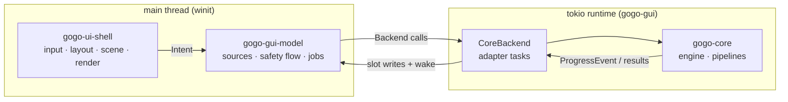
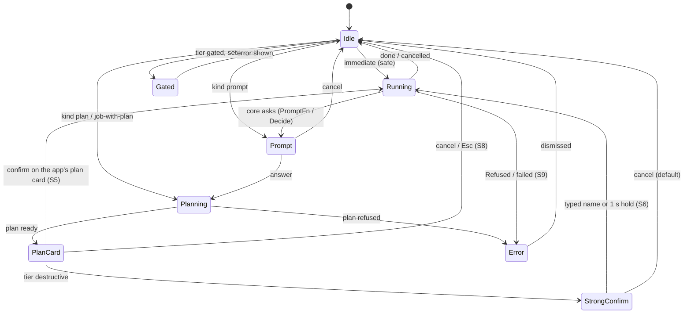

# 25 — Desktop GUI: the app layer (#520)

Status: **accepted** (2026-11-25), not built yet (PR D1 and PR D2 in design 24 §8). This doc covers how the
GUI talks to `gogo-core`: threads, the `Backend` seam, how live data reaches a skin without
flooding it, the safety flow, and long-running jobs. The crates are in design 24 §2. The
contract the model implements (sources, actions, kinds, tiers, invariants) is
design 26, and the skin format design 27 (both added in #557).

## 1. Threads and runtime



1. **winit owns the main thread.** macOS requires it, and winit 0.30 wants it everywhere.
   - Input, binding, layout, scene building and rendering run there.
   - So does the model's state, so the model needs no locks of its own beyond the slots (§3).
2. **`gogo-gui` starts a tokio multi-thread runtime before the event loop.** The features
   are the workspace's (`rt-multi-thread`, `macros`, `signal`, `fs`, `io-util`, `time`) plus `sync` (for
   `watch` and `oneshot`). gogo-core's async APIs run there unchanged.
3. **Synchronous pipelines run under `tokio::task::spawn_blocking`.** They don't share
   one callback type; the adapter maps each into the job's slot (§3):

   | Pipeline | Callback | Adapter |
   |---|---|---|
   | `linuxapp::build::{plan, execute}`, `macapp::{plan, execute}`, `linuxapp::setup::*`, `linuxapp::snapshots::{before_change, protect}` | `emit: &mut dyn FnMut(&ProgressEvent)` | the same fold as the broadcast events, including the `Work*` step events |
   | `linuxapp::convert` (subvolume conversion) | `emit: &mut dyn FnMut(ConvertProgress)` (`Copying`/`Verifying {done, total}`) | one step with a byte fraction |
   | `macapp::relocate::move_game` | `emit: &mut dyn FnMut(&MoveEvent)` (`Copying`/`Verifying {done, total}`) | one step with a byte fraction |
   | `linuxapp::snapshots::make_dir` | `warn: &mut dyn FnMut(String)` | a warning line on the job |
   | `linuxapp::doctor::doctor` | none: returns a `Report` | no progress; the job shows a busy step until it returns |
4. **`gogo-gui-model` has no runtime.** `Backend` methods are synchronous and return
   handles. `CoreBackend` in the binary does the spawning. The model and the safety flow
   are tested with plain `#[test]`s and a `FakeBackend`.

## 2. The `Backend` seam

`Backend` is the only thing the model knows about an engine. It's shaped after the contract,
not after gogo-core:

```rust
pub trait Backend {
    /// Start feeding a source; values arrive through the slot (§3).
    fn subscribe(&self, source: &SourceKey, slot: Slot) -> Subscription;
    /// Pure planning for a `plan` action: computes, changes nothing (design 26 §4).
    fn plan(&self, action: &ActionCall) -> Result<PlanHandle, ErrorView>;
    /// Run an immediate action, or a confirmed plan.
    fn run(&self, call: Run, job: JobSink) -> Result<JobId, ErrorView>;
    fn cancel(&self, job: JobId);
}
```

- **`CoreBackend`** maps each source to gogo-core reads:
  - `library` → `gog::library::list_games` plus `state` records;
  - `game(id)` → catalog plus state;
  - `queue` → the job table.

  Each `plan` action maps to the core's pure `plan()` function. That pattern already exists:
  `engine::plan`, `linuxapp::build::plan` ("downloads nothing"), `cloud::status::plan`.
  Running a plan maps to the matching `execute()`.
- **`FakeBackend`** (in `gogo-gui-testkit`) serves fixture data and records calls. Tests,
  `gogo-gui --render-png` and skin dev mode (§8) all use it.

## 3. Sources, coalescing and wakeups

**Rule: a producer overwrites; it never queues.** In the prototype, lavapipe frames fell
seconds behind a 10 Hz progress feed because every update queued a frame (design 24 §6).

- **One slot per source key.** A source key is a source name plus its parameters
  (`game(<id>)`). The slot is a latest-value cell: a value and a generation counter.
  Writers replace the value and bump the generation.
- **At most one wake per frame.** Each write sets a shared `AtomicBool dirty`, and only on
  the false → true edge calls `EventLoopProxy::send_event(Wake)`. The main thread clears the
  flag, reads every slot whose generation moved, re-binds the affected routes and draws
  once.
- **Frame pacing is the shell's.** Changes that only touch progress are drawn at most
  10 times a second per source (design 26 §3.4). Input-driven changes are drawn at once.
- **Download progress** comes from one adapter task per job. The two download lanes
  report differently:
  - **Offline installers** (`engine::execute`) broadcast `ProgressEvent`s on `ctx.events`.
    The task subscribes and folds them into a `Job` value: bytes, total, rate, ETA, files
    and steps.
  - **Depot downloads** (`gog::depot::run`) send `DepotEvent`s (`gog/depot.rs`) on an
    `mpsc::UnboundedSender` the caller passes in. The task owns the receiver and folds them
    into the same `Job` shape. An unbounded channel queues, so the fold must keep up; it
    only updates numbers, and the slot write keeps only the newest value.
  - It writes the job's slot after each event.
  - On `RecvError::Lagged` it carries on. `ChunkDone.file_bytes` is cumulative (01 §4), so
    any later event re-syncs it.
  - Rate and ETA are smoothed over a short window in the adapter. Skins get numbers, never
    pre-formatted strings.
- **Re-binding cost.** Templates are parsed once at load (design 27 §9), so a re-bind only
  evaluates. If that ever shows up in a profile, progress nodes are marked in the IR
  (design 27 §5.6) and can be patched without a full bind.

## 4. The safety flow

The safety flow lives in `gogo-gui-model` (`SafetyFlow`), between the dispatcher and the
backend.

- A skin's only way to cause anything is an `Intent::Invoke(ActionRef, args, provenance)`.
- `gogo-ui-interact` creates one only for a real pointer, key or AccessKit activation on a
  node whose binding names the action. It creates at most one per input event (S4).
- The model looks up the action's kind and tier in `gogo-contract` and goes through the
  states below.
- App-owned widgets are built as IR by the app, not by the skin. They are styled by the
  skin's tokens and part styles, and drawn on top of the skin's tree (S7).



| Invariant (design 26 §7) | Enforced in | Proven by |
|---|---|---|
| S4 actions only from input | `gogo-ui-interact` creates provenance; the model rejects an `Invoke` without it | interact test: load, hover, focus and timers fire nothing; one action per event |
| S5 every plan shows first | `SafetyFlow` runs a plan only on `Intent::Confirm` from the app-drawn (`DrawnBy::App`) plan-card confirm control. The skin format has no "confirm" action | model test: a skin button bound to the action leads to `PlanCard`, never `Running` |
| S6 strong confirmation | `StrongConfirm` state; the default answer is no | model test per destructive action |
| S8 cancel always there | every dialog state has a cancel edge that changes nothing | model test: cancel from each state leaves the backend untouched |
| S9 uniform errors | every `Refused`/failure becomes an `ErrorView` in the app's `error` widget | model test |
| S19 global keys | the shell routes Ctrl K, Esc and the plan card's Enter before the skin sees them | interact test |
| S1–S3 nothing secret or path-like in sources or args | `CoreBackend` builds sources from typed views; action params have no path/URL/shell types | S1 test over a fixture account with known secret strings |

- **The plan the user confirmed is the plan that runs.** Confirming re-plans and compares.
  If the plan changed meanwhile, the run is refused and the new plan is shown. A
  `plan.preview` placed inline by a skin is read-only until confirmed the same way.
- **Prompts from core pipelines.**
  - The core asks through `PromptFn` (`macapp::prompt`) and the cloud-save `Decide` trait.
  - `CoreBackend` implements both. It blocks the worker thread on a `oneshot`, and the model
    enters `Prompt`.
  - The prompt is drawn with the same app-owned `prompt`/`picker`/`saves-conflicts`
    widgets as a skin-started prompt.
  - Cancel answers `None` or `Confirm::No`, and the pipeline stops without changes (S8).
- **Secret input** (the sign-in code, revealing or editing an env value) stays inside
  depth-A app widgets. The value goes straight to the core and never enters a source or the
  binding scope (S1, S2).

## 5. Jobs, progress and cancellation

- **The job table.** `JobTable` in the model holds one entry per long-running action:
  - an id and the action;
  - a state: `queued`, `running`, `paused`, `failed`, `done` or `cancelled`;
  - a progress slot;
  - a cancel handle.

  It feeds the `queue`, `queue.summary` and `job(id)` sources (design 26 §3.4).
- **Steps.** Install pipelines report `WorkStarted/WorkProgress/WorkDone` and their step
  events. These map onto `Job.steps`, drawn by the stock `step-list` component or by a
  skin's own rebuild.
- **Toasts** fire on start, finish and failure only.
- **Per-job cancellation needs a core change (PR D2, #532).** `AppContext.cancel` is one
  `CancellationToken`, which suits a CLI process running one command. Cancelling one GUI job
  must not stop the others.
  - **The change:** the download and pipeline entry points take a token, and the GUI passes
    `ctx.cancel.child_token()` per job. The CLI keeps passing `ctx.cancel` itself, so its
    behaviour is unchanged.
  - **Until it lands,** the GUI runs one download job at a time, and cancel stops it.
- **Cancel leaves resumable state**, as Ctrl C does in the CLI: sidecars stay (04 §4), and
  the job shows `cancelled` with a resume action.

## 6. Errors

- Every failure reaches the model as an `ErrorView {class, title, message, hint, exit_class}`.
  It is built from the core's thiserror enums, which are already redacted at construction
  (07 §4).
- The class word (Network, Disk, Auth, …) is the same one the CLI uses for its exit
  classes (07 §2).
- Skins may draw their own error states from an action's `last_error`, but the app's
  `error` widget is always shown as well (S9).

## 7. Images

- Cover art is fetched by `CoreBackend` and decoded off the main thread with `image`
  (`jpeg` and `webp` only), with dimension and byte limits. Decoding runs inside
  `catch_unwind`, since decoders can panic on hostile input.
- The decoded image reaches the scene as an `ImageId`, and skins never see a URL (S3).
- The GPU renderer uploads it into a texture cache with a byte budget (design 28 §4).

## 8. Skin dev mode

- **`gogo-gui --dev <skin dir>`:**
  - watches the skin folder (notify) and re-loads it on change;
  - shows validator diagnostics in an app-owned panel;
  - adds an inspector that shows each node's bindings and their current values.
- **Data.** Dev mode runs on `CoreBackend`, or on fixture data with `--fixture`.
- **`gogo-gui --check-skin <dir>`** validates without a window, for skin authors and CI.

## 9. Where things are stored

Paths follow 06 §1 (the `dirs` crate), which lists these rows too. With `GOGO_HOME` set,
they move under it like everything else: `$GOGO_HOME/skins/`, `$GOGO_HOME/gui/` (state)
and `$GOGO_HOME/gui-cache/` (cache), so state and cache stay apart.

| What | Linux | macOS |
|---|---|---|
| Installed skins | `$XDG_DATA_HOME/gogo/skins/<name>/` | `~/Library/Application Support/gogo/skins/<name>/` |
| Per-skin UI state (design 26 §6.4) and the active skin | `$XDG_STATE_HOME/gogo/gui/` | `~/Library/Application Support/gogo/gui/` |
| Pipeline cache, decoded covers | `$XDG_CACHE_HOME/gogo/gui/` | `~/Library/Caches/gogo/gui/` |

- Every file is written atomically (tmp, fsync, rename) like `state.json`.
- An unreadable cache is ignored.
- Unreadable UI state falls back to the skin's declared defaults.
