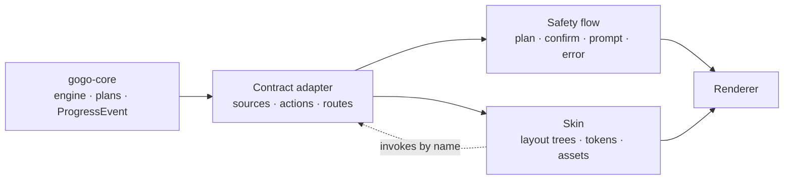

# 26 — Skin contract (#520)

Status: **accepted** (2026-11-25). **Contract version 1.0 (draft)**: it stays a draft
until the first GUI release, then freezes as 1.0 (§8). The crate is `gogo-contract`
(design 24 §2). This is the reference for skin authors as well as for the code.

This doc is what the app guarantees every skin, and what every skin has to go through. A
skin decides *where* and *how* things are drawn. The app owns:
- *what* is drawn: the data;
- *what happens*: the actions;
- *whether it is safe*: the safety flow.

The format skins are written in is design 27. How the app implements this contract is
design 25.

The contract was mapped from the CLI surface (designs 03, 07, 12, 18–23) as of 2026-11-25.
Every source and action names the CLI command it stands for, so a new CLI feature has an
obvious place to land here. It needs a pass whenever a CLI feature lands.

## 1. Layers

- **The adapter is the only thing a skin talks to.**
  - It turns engine state into typed, masked, read-only *sources*.
  - It turns named *actions* into engine calls.
- **The safety flow is drawn by the app**, on top of or inside whatever the skin draws.
  Skins can style it; they can't reach behind it.
- **The default skin is written in the same format against the same contract.** It is
  the reference skin, and the test suite loads it through the public loader (S17).

## 2. Types

| Type | Meaning | Helpers a skin may call |
|---|---|---|
| `Text` | display string, already localised | pipe stages `upper`, `lower`, `trim n` (design 27 §7) |
| `Bytes` | u64 | `fmt.bytes(x)` → "18.6 GB", `fmt.rate(x)` → "48.2 MB/s" |
| `Time` | instant | `fmt.date`, `fmt.ago` → "2 days ago" |
| `Duration` | span | `fmt.hours` → "41 h", `fmt.eta` |
| `Fraction` | 0.0–1.0 | `fmt.pct` → "62%" |
| `Number` | a count or another plain number | compared and negated; there is no arithmetic |
| `Bool` | yes or no | `not`, `and`, `or` |
| `GameId` | numeric GOG id | opaque in skins: only passed to actions |
| `JobId` | a job's id | opaque in skins: only passed to actions |
| `Art` | image handles `cover`, `background`, `logo`, plus `colors: [Color; 2]` | used by `art`/`image` elements only; never a URL |
| `Status` | `ready · running · downloading · setting_up · update_available · failed · not_installed · queued · paused` | `status.word(s)`, `status.tone(s)` → a token name |
| `Os` | `windows · mac · linux` | |
| `RichText` | a game's description as paragraphs, with links and HTML removed | shown whole, as text; never parsed by a skin |
| `ActionRef` | an action and its arguments, chosen by the app (a doctor check's fix) | opaque in skins: only tested for null in contract 1.0 |
| `Masked<T>` | a value, or `•••` with `secret: true`; the clear value is never in the binding scope | |
| `List<T>` | ordered, virtualised | `where`, `sort`, `take`, `len`, `first` in expressions |
| `Option<T>` | may be null | `?.` and `else` in expressions |

Sizes, times and counts arrive as numbers, never pre-formatted strings. A skin can then
draw an LCD readout, a bar or a sentence from the same field.

## 3. Data sources

**Field types.** A field written without a type is `Text`, and `name?` is `name: Text?`.
`gogo_contract::shapes` holds the same shapes as data; a test keeps the two in step. The
loader checks every field path a skin names against them (S16, design 27 §7).

Columns: **Source** (name and parameters), **Shape**, **Live** (how it updates), **From**
(the CLI command it stands for).

- **Event:** the source updates when the engine reports a change: a job event, a setting
  written, a refresh finished.
- **On demand:** the source is computed when a route asks for it and when its refresh
  action runs. A record-shaped one carries `checked_at: Time`.
- **Live** job sources update at most 10 times a second each, and only the newest value is
  kept (design 25 §3).

### 3.1 Account and app

| Source | Shape | Live | From |
|---|---|---|---|
| `account` | `{ signed_in: Bool, username: Text?, avatar: Art? }` | event | `whoami` |
| `app` | `{ version, contract, os: Os, reduced_motion: Bool, high_contrast: Bool, big_screen: Bool, locale }` | event (OS setting change) | — |
| `ui` | the skin's own declared local state (§6.4) | on write | — |
| `route` | `{ current: shell\|sign-in\|library\|game\|queue\|updates\|saves\|apps\|runtimes\|doctor\|settings\|about }` | event (navigation) | — |

`route.current` is the name of the route on screen (§6.2). A skin tests it to show which
nav button is current: `button … on="{route.current == library}"`. The route's own
parameters are not in the shape: they differ per route and have no one type, and a route reads its own
as `$name` (design 27 §7).

### 3.2 Library and search

| Source | Shape | Live | From |
|---|---|---|---|
| `library(filter?, sort?)` | `List<GameSummary>`; filter `{ text, os, installed, with_dlc, category }` | event | `list` |
| `library.stats` | `{ count: Number, installed: Number, disk_bytes: Bytes, updates: Number }` | event | `list` |
| `search(query, categories?, os?, owned?)` | `List<SearchHit{ kind: game\|dlc\|pack\|goodie, id: GameId, title, owned: Bool, os: [Os], art: Art }>` | on demand, debounced | `search` |

`GameSummary` = `{ id: GameId, title, art: Art, status: Status, platforms: [Os], runs_via: Text?, size_on_disk:
Bytes?, playtime: Duration?, last_played: Time?, progress: Fraction? (while a job runs),
update: UpdateHint? }`. `BuildRef` = `{ version, build_id }`.

### 3.3 One game

| Source | Shape | Live | From |
|---|---|---|---|
| `game(id)` | `GameSummary` + `{ slug, genre, year: Number, developer, publisher, description: RichText, languages: [Text], installed_build: BuildRef?, lane: installer\|depot\|linux_app\|mac_app\|none, running: Bool }` | event | `info`, `apps show` |
| `game.builds(id, os?)` | `List<Build{ version, build_id, date: Time, size: Bytes, generation: 1\|2, legacy: Bool, newest: Bool, this_machine: Bool }>` | on demand | `builds` |
| `game.files(id)` | `List<FileEntry{ kind: installer\|patch\|extra\|lang_pack, os: Os, lang, name, size: Bytes, downloaded: Bool, verified: Bool? }>` | event | `download --dry-run`, `verify` |
| `game.dlc(id)` | `List<Dlc{ id: GameId, title, owned: Bool, installed: Bool, download_size: Bytes, disk_size: Bytes, in_this_build: Bool }>` | event | `linux-app dlc list` |
| `game.saves(id)` | `{ state: in_sync\|to_pull\|to_push\|conflicts\|disabled\|no_remote_config, last_sync: Time?, counts{pull: Number, push: Number, delete: Number, conflict: Number}, files: List<SaveFile{ display_path, action, conflict: Bool, local_time: Time?, cloud_time: Time? }>, quota: Bytes?, checked_at: Time }` | on demand + event | `saves status`, `saves locations` |
| `game.snapshots(id)` | `{ auto: Bool, items: List<Snapshot{ n: Number, date: Time, kind: initial\|manual\|auto, label, build, dlc_count: Number, exclusive: Bytes?, estimate: Bool }> }` | event | `snapshot list` |
| `game.runner(id)` | `{ platform: linux\|mac, renderer, renderer_options: [Text], runtime{id, version}, runtime_options: [Text], display{mode: wayland\|x11, hdr: Bool, monitor?}, galaxy{setting: on\|off\|default, state: signed_in\|signed_out\|not_installed}, wrapper: [Text], args: [Text] }` | event | `compat`, `galaxy`, `display`, `args`, `wrapper` |
| `game.env(id)` | `List<EnvVar{ name, value: Masked<Text>, source: default\|renderer\|compat\|override\|launcher\|protonfix, beats: [source], locked: Bool }>` | event | `env list` |
| `game.exes(id)` | `List<Exe{ n: Number, name, category, primary: Bool, launched: Bool, bits: Number }>` | on demand | `exes` |
| `game.doctor(id)` | `{ checked_at: Time, summary{ok: Number, warn: Number, fail: Number}, checks: List<Check{ name, result: ok\|warn\|fail, message, hint, fix: ActionRef? }> }` | on demand | `linux-app doctor`, `mac-app doctor` |
| `game.compat(id)` | `{ items: List<CompatValue{ key, value, source }>, protonfix: Text?, checked_at: Time }` | on demand | `compat` |
| `game.recipes(id)` | `List<Recipe{ slug, rank: Number, steps: [{verb, applied: Bool, reason}] }>` | on demand | `recipes list/show` |

### 3.4 Jobs

Live job sources update at most 10 times a second each, and keep only the newest value
(design 25 §3).

| Source | Shape | Live | From |
|---|---|---|---|
| `queue` | `List<Job>` | live | `ProgressEvent`, depot and `Work*` events |
| `queue.summary` | `{ active: Number, queued: Number, rate: Bytes, rate_limit: Bytes?, current: Job? }` | live | same |
| `job(id)` | `Job` | live | same |
| `job.log(id)` | log lines, **only** through the app-owned `log-view` widget | live | run logs, setup output |

`Job` = `{ id: JobId, kind: download|depot|update|setup|dlc_add|dlc_remove|saves|runtime_install|move|rollback|verify,
game: GameSummary?, state: queued|running|paused|failed|done|cancelled, steps: List<Step{ name,
state: done|now|pending|failed|asks_first, took: Duration? }>, bytes: Bytes, total: Bytes?, rate: Bytes, eta: Duration?, fraction: Fraction?,
files: List<FileProgress{ name, bytes: Bytes, total: Bytes, chunks_done: Number, chunks_total: Number, state }>, error: ErrorView?, stoppable: Bool }`.

While `stoppable` is false the job is in a step that must not be cut short: the app refuses
`job.cancel` and `job.pause` for it and refuses to close its window, and a skin shows
neither button.

Every long-running action becomes a job. A skin may draw the step list as a list, a row of
pads or a table of contents (§5: these are stock components).

### 3.5 Machine and settings

| Source | Shape | Live | From |
|---|---|---|---|
| `updates` | `List<UpdateHint{ game: GameSummary, from, to, size: Bytes, removes_dlc: Bool }>` | on demand + event | `update`, `builds --installed` |
| `apps` | `List<App{ game: GameSummary, entry_kind: menu\|app_bundle, runtime, renderer, dlc: Number, size: Bytes, last_launch: Time? }>` | event | `apps list` |
| `runtimes`, `renderers` | `List<CatalogEntry{ id, latest, cached: [Text], used_by: [GameSummary], os: Os }>` | on demand | `runtimes list`, `renderers list` |
| `doctor.all` | `List<{ game: GameSummary, summary{ok: Number, warn: Number, fail: Number} }>` | on demand | `doctor` for every app |
| `settings` | `List<Setting{ key, type, value, default, source: file\|env\|default, description, choices: [Text]? }>`; `value` and `default` are text, a number or a yes/no, as `type` says | event | `config get` |

### 3.6 Plan previews

| Source | Shape | Live | From |
|---|---|---|---|
| `plan.preview(action, args)` | `Plan`, or null when the action has nothing to do | on demand; recomputed on events that touch the game | the action's `--dry-run --json` |

`Plan` = `{ verb ("Update"), title ("Update to 1.5.0?"), tier, steps: List<PlanStep{ kind:
download|replace|delete|snapshot|move|info, text, bytes? }>, totals{ download?, disk_delta? },
warnings: [Text], reversible }`.

- **A preview is read-only.** It lets a skin place a plan inline, for example an update
  plan on the game page, before the user asks.
- **It is only ever shown through the app-owned `plan-card`.**
- **Confirming it runs the real action.** The action re-plans and refuses if the plan
  changed meanwhile (design 25 §4).

### 3.7 What no source ever contains

1. **Credentials.** OAuth tokens, the login code, cookies, client secrets and password
   values are not fields of any source. They aren't masked; they are absent. `auth.*`
   settings are left out of `settings`.
2. **Secret env values in clear.** A variable is secret by the CLI's `is_secret` rule: its
   name contains TOKEN, SECRET, PASSWORD, PASSWD, API_KEY, APIKEY, CREDENTIAL, AUTH or
   PRIVATE. Its value is `Masked`. The clear value exists only inside the app-owned
   `env-table` after an explicit reveal.
3. **URLs.** CDN, store and API links stay inside the app. A skin opens a page with
   `app.open_url(kind)`.
4. **Paths**, except as `display_path`: home shortened to `~` and scrubbed like CLI
   output. No action takes a path from a skin.
5. **Raw errors.** Errors arrive as `ErrorView{ class, title, message, hint, exit_class }`,
   in gogo's own words and scrubbed (07 §4).

## 4. Actions

An action is invoked by name from a bound user input (S4). It has typed parameters, a
**kind** and a **tier**.

- **Kind:**
  - `immediate`: does it now.
  - `plan`: the app computes a plan, shows it, and runs it only after confirmation.
  - `prompt`: the app collects input in its own dialog first.
  - `job`: starts a job, possibly after a plan.
- **Tier:**
  - `safe`: reversible or trivially undone.
  - `confirm`: the plan must be confirmed.
  - `destructive`: strong confirmation (S6).
  - `gated`: also needs a setting to be on, such as cloud writes.

**The app decides kind and tier from the computed plan, never from the skin.** The tables
below give each action's usual kind and tier, but some depend on what the plan turns out
to contain:
- `game.update` is destructive when its plan removes DLC or downgrades, and so is
  `updates.apply_all` when that is true of any game in the batch;
- `runner.set_runtime` becomes plan → job when a download is needed, and
  `runner.set_galaxy` becomes a plan when Comet must be downloaded;
- `game.move` is destructive when its plan crosses filesystems (snapshots are deleted);
- `account.sign_out` is destructive with `purge_state`.

The app plans first, then applies the strongest tier the plan calls for. A skin can't ask
for a weaker one; nothing in the format can name a kind or a tier.
- A plan that changes anything is always shown and confirmed, even for an action that is
  usually immediate (S5). A plan with nothing to do runs nothing.
- A `gated` action is refused while its setting is off. The app checks the gate before it
  plans, whatever the skin binds.

**Input variables.** Two names are bound to a control's input when its action fires:
- `value`: the option a `select` was set to;
- `on`: a `toggle`'s state before the input.

Only `toggle` and `select` have an input, so only their `args` may use these names. An arg
that uses one is evaluated at input time, not when the route binds. The loader rejects them
on any other element.

**Results.** Every action returns `Accepted`, `Refused(ErrorView)` or `Cancelled`.
- A skin can bind an action's read-only `busy` and `last_error`.
- All results land in sources.

### 4.1 Navigation and shell

| Action | Params | Kind / tier |
|---|---|---|
| `nav.go` | `route, params` | immediate / safe |
| `nav.back` | — | immediate / safe |
| `palette.open` | `scope?` | immediate / safe (the app-owned palette) |
| `account.menu` | — | immediate / safe: opens the app-owned account menu (who is signed in, sign in or out, which lead to the `account.*` actions below) |
| `ui.set` | `var, value` (skin-local state only) | immediate / safe |
| `clipboard.copy` | a bound non-secret field | immediate / safe |

### 4.2 Account

| Action | Params | Kind / tier | Notes |
|---|---|---|---|
| `account.sign_in` | — | prompt / safe | The app opens GOG's page in the browser and shows its own code dialog. The code never enters the skin |
| `account.sign_out` | `purge_state` | plan / confirm; destructive with `purge_state` | The plan lists what is deleted |
| `library.refresh` | — | immediate / safe | |

### 4.3 Play, files, verify

| Action | Params | Kind / tier | Notes |
|---|---|---|---|
| `game.play` | `id, exe?` | immediate / safe | Refused while running, or while setup or a DLC add is pending (the CLI's rule) |
| `game.download` | `id, selection: {os, lang, kinds, dlc}?` | plan → job / confirm | Without a selection: installers for this system (Windows ones, with a warning, when the game has none) in the configured language, no extras and no DLC. The plan shows size and the disk check. Too little space → `Refused` (class Disk) |
| `game.verify` | `id` | job / safe | Corrupt files end the job `failed` (class CORRUPT) and offer `game.verify_fix` |
| `game.verify_fix` | `id` | plan → job / confirm | The plan lists files to re-download |
| `game.open_folder` | `id, which: game\|prefix\|logs\|saves` | immediate / safe | The app resolves the path; the skin never sees it |

### 4.4 Builds and updates

| Action | Params | Kind / tier | Notes |
|---|---|---|---|
| `game.update` | `id, build?` | plan → job / confirm; **destructive** if the plan removes DLC or downgrades | The plan shows size, files changed or removed, a snapshot first, and DLC removed. With DLC removal the default answer is no, as in the CLI |
| `updates.apply_all` | `ids?` | plan → jobs / confirm; **destructive** if the plan removes DLC or downgrades | One combined plan card. One game that loses DLC or downgrades makes the whole batch destructive |
| `game.update_finish`, `game.update_undo` | `id` | plan / confirm | For half-laid updates |

### 4.5 Set up for this machine (Linux, Mac)

| Action | Params | Kind / tier | Notes |
|---|---|---|---|
| `game.build` | `id, platform, runtime?, renderer?, dlc?, lang?, build?` | plan → job / confirm | An omitted `runtime`, `renderer`, `lang` or `build` takes `linux-app`'s default, shown on the card (no picker yet). `runtime` takes a catalog id only: a `path:` runtime is refused and stays a CLI feature. An omitted `dlc` takes every owned DLC of the build; a rebuild keeps its recorded set. D3DMetal consent, Galaxy `ask` and the other asked-once choices are app prompts, all asked before the plan card |
| `game.setup` | `id` | plan → job / confirm | It can download a runtime and create a prefix. Its questions are asked before the plan card |
| `game.move` | `id, target: default\|chosen` | plan → job / confirm; **destructive** across filesystems (snapshots are deleted) | The folder is chosen in the app's native dialog |
| `game.remove` | `id, keep_override` | plan / **destructive** | Deletes prefix and saves; refused while running |
| `apps.prune_orphaned` | `keep_override` | plan / **destructive** | |
| `runner.set_renderer` | `id, renderer` | immediate / safe | Applies on next launch |
| `runner.next_renderer` | `id` | immediate / safe | None left → `Refused` |
| `runner.set_runtime` | `id, runtime` | immediate, or plan → job if a download is needed / confirm | |
| `runner.set_display` | `id, mode?, hdr?, monitor?` | immediate / safe | |
| `runner.set_galaxy` | `id, on\|off\|default` | immediate; plan if Comet must be downloaded | |
| `runner.edit_args`, `runner.edit_wrapper` | `id` | prompt / safe | App-owned input with the CLI's validation |
| `env.edit` | `id, name?` | prompt / safe | App-owned editor. `name` must be an existing row of `game.env(id)` (bound as `{row.name}`); without it the editor asks for a new name itself. Launcher-owned names refused |
| `env.unset` | `id, name` | plan / confirm | `name` must be an existing `game.env(id)` row. Confirm, because unsetting an override can lose a value (a secret can't be shown again) and changes how the game starts; the plan names the variable and what takes its place |
| `env.reveal` | `id, name` | **app-only** | Not bindable by skins; only the env widget's own control |
| `exe.run` | `id, n` | immediate / safe | Refused while the game or another run is active |

### 4.6 DLC

| Action | Params | Kind / tier | Notes |
|---|---|---|---|
| `dlc.add` | `id, dlc: [id]\|all` | plan → job / confirm | No selection → the app's picker |
| `dlc.remove` | `id, dlc: [id]` | plan → job / **destructive** | The plan warns that saves made with the DLC may not load |
| `dlc.abandon` | `id` | plan / confirm | Discards a half-done add or remove |

### 4.7 Snapshots

| Action | Params | Kind / tier | Notes |
|---|---|---|---|
| `snapshot.create` | `id` | prompt → plan / confirm | Label prompt; the plan notes a subvolume conversion if needed |
| `snapshot.delete` | `id, n: [n]` | plan / **destructive** | Always asks; `initial` is named |
| `snapshot.rollback` | `id, n, drop_saves` | plan / **destructive** | The plan shows the pre-rollback snapshot and the newer saves copied aside |
| `snapshot.set_auto` | `id, on` | plan / confirm (on), immediate (off) | |

### 4.8 Cloud saves

| Action | Params | Kind / tier | Notes |
|---|---|---|---|
| `saves.check` | `id` | immediate / safe | Refreshes `game.saves` |
| `saves.pull` | `id, prefer?` | plan → job / confirm | Conflicts open the app-owned resolver; refused while the game runs |
| `saves.push`, `saves.sync` | `id, prefer?, no_delete?` | plan → job / **gated** + confirm | Gated by the cloud-writes setting (the GUI's `GOGO_CLOUD_WRITES=1`) |

### 4.9 Queue and machine

| Action | Params | Kind / tier |
|---|---|---|
| `job.pause`, `job.resume`, `job.retry` | `job` | immediate / safe |
| `job.cancel` | `job` | immediate / safe (state stays resumable, like Ctrl C) |
| `queue.set_rate_limit` | `rate: Bytes?` | immediate / safe |
| `runtimes.install`, `renderers.install` | `id, version?` | plan → job / confirm |
| `runtimes.prune`, `renderers.prune` | `unused\|id` | plan / confirm (never removes versions in use) |
| `doctor.run` | `id?` | immediate / safe |
| `doctor.stop_leftovers` | `id` (mac) | plan / confirm |
| `settings.set` | `key, value` | immediate / safe, **only for the skin-settable keys below**; validated like `config set` |
| `settings.open_file` | — | immediate / safe |
| `app.open_url` | `kind: store_page\|support\|login\|docs, id?` | immediate / safe |

**Skin-settable settings.** `settings.set` from a skin accepts only an allow-list of keys
that change looks or comfort, never safety. In contract 1.0 these are:

- the GUI's own appearance keys, added with the GUI: `gui.skin`, `gui.mode` (dark or
  light), `gui.reduced_motion`, `gui.big_screen`;
- `download.limit` (05; also reachable through `queue.set_rate_limit`).

A setting is **app-only** when it gates an action or weakens a confirmation. Examples are
the cloud-writes gate on `saves.push`/`saves.sync`, anything that skips a prompt or a plan,
and auth settings. Today the cloud-writes gate is only the `GOGO_CLOUD_WRITES=1`
environment variable; its settings key, `cloud_saves.writes`, is reserved as app-only now,
so S21 covers it as soon as a settings route can change it. Only the app's own settings
route changes an app-only setting, through an app-owned control. The validator rejects a skin that binds `settings.set` to a key
outside the list (S21). The list only grows in minor versions (§8).

### 4.10 Deliberately not actions

- Anything that takes a path, URL, shell command or environment value **from the skin**.
- Reading a secret, the clipboard or any file.
- Changing an app-only setting (§4.9, S21).
- Starting another skin, loading code, or changing the active skin's files.
- The CLI's internal commands (`__shim`, `__pe-scan`) and `completions`.

## 5. App-owned widgets

Some widgets carry the safety flow or secrets, so the app draws them. Each reads only
semantic tokens (§6.1). They come in three **depths**:

| Depth | A skin may change | A skin may not change |
|---|---|---|
| **A. Tokens only** | colours, fonts, radius, elevation and motion, through semantic tokens | layout, parts, wording, placement (always modal, centred) |
| **B. Parts + variants** | A, plus per-part styles (fill, border, font, padding, effects), a fixed set of variants, and placement (inline slot or modal) | content, order, which buttons exist, key bindings, masking |
| **C. Stock** | everything: these are ordinary components in the default skin, which a skin may copy, change or replace | — (they carry no safety duty) |

| Widget | Depth | Parts / variants | Notes |
|---|---|---|---|
| `plan-card` | B | parts `frame, body, header, title, badge*, steps, step, step.kind-icon, totals, warning, footnote, actions, confirm, cancel`; variants `labels: verb\|generic`, `layout: stacked\|side`, `markers: number\|arrow\|none`, `density: full\|compact`; placement `inline(slot)` or `modal` | Content and wording come from the `Plan`. "Nothing changes until you confirm" is always shown. Enter confirms, Esc cancels |
| `confirm-destructive` | A | — | Always modal. Typed confirmation (the game's title) or a 1 s hold, chosen by the app per action |
| `prompt` | B | parts `frame, label, field, hint, error, ok, cancel` | Validation is the CLI's |
| `secret-input` | A | — | Sign-in code, env value edit. The input never enters the binding scope |
| `picker` | B | variant `layout: list\|grid\|keys` | Choices inside a plan flow (runtime, renderer, build, DLC). Skins build their own selectors for immediate actions from `game.runner` |
| `saves-conflicts` | B | parts `row, side.local, side.cloud, choice` | One decision per file; nothing applied until all are decided |
| `env-table` | B | parts `frame, header, title, row, name, value, source, masked, reveal, edit`; variant `row-actions: inline\|menu` | Masking and reveal are the app's. A reveal shows the value for 30 s, inside the widget only |
| `log-view` | B | parts `frame, line, line.warn, line.error, timestamp` | Virtualised, scrubbed text; skins never get log lines as data |
| `error` | B | parts `frame, title, message, hint, actions` | The class word is always shown |
| `toast` | B | parts `frame, icon, title, message, action, dismiss`; variant `corner: bottom-right\|bottom-left\|top-right\|top-left` | Start, finish and failure only. Always an overlay on top of the page, never inline; the corner defaults to `bottom-right` |
| `palette` | B | parts `frame, field, item, item.key-hint, group` | Ctrl K (Cmd K on macOS) always opens it (S19) |
| `focus-ring` | A (a skin may draw its own) | — | If a skin's focus style fails S13, the app's ring is drawn on top |
| `step-list`, `progress`, `chunk-bar`, `game-card`, `tabs`, `status-badge`, `meter` | **C** | — | Stock components in the default skin |

- **What the prototype has proven.** `plan-card` with `placement=inline`, the `labels`,
  `layout` and `markers` variants, and the parts `frame, body, header, title, badge, steps,
  step, footnote, actions, confirm, cancel`. `env-table` with every part listed here except
  `source`. Everything else in this table is **specified but not yet built**: the other
  widgets, `placement=modal`, `density`, `step.kind-icon`, `totals`, `warning`, and
  `env-table`'s `source`. PR B2 encodes the table, and each is reconciled when its widget
  is built.
- **Optional parts** are the ones marked `*`. A skin may hide them with
  `part "badge" hidden=#true`. Every other part is always drawn. The plan card's `footnote`
  and `confirm` can never be hidden, and the loader rejects a skin that tries (S5).
- **Unknown names are load errors**, whether a part name or a variant value.
- **`data-table` is a built-in element of the format, not a widget** (design 27 §5.4). It
  carries no safety duty.

## 6. Tokens, routes and skin state

### 6.1 Semantic tokens

App-owned widgets read only these. A skin may define any number of its own tokens, and
app widgets ignore those.

- **Colours:** `bg0 bg1 surface raised border outline text-hi text-md text-lo accent
  on-accent focus success warn error info scrim`, plus status tones `tone.ready
  tone.running tone.downloading tone.setting_up tone.update tone.failed
  tone.not_installed tone.queued tone.paused`.
- **Type roles:** `font.display font.title font.body font.label font.mono`, each with
  family, size and weight.
- **Shape:** `radius.sm/md/lg`, `space.1…8`, `elevation.0…3` (a number), `stroke.thin/thick`.
- **Motion:** `motion.fast/normal/slow` and `easing.*`, whose value is one of `linear`,
  `ease`, `ease-in`, `ease-out`, `ease-in-out`.

Every `Status` value has exactly one tone, and `update_available` uses `tone.update`. A
skin that doesn't define `tone.queued` or `tone.paused` gets `text-lo` for queued and `warn`
for paused.

Effects use CSS units, so every renderer draws the same width (design 27 §6). Borders
take layout space (CSS `border-box`).

### 6.2 Routes

The set is fixed. A skin covers some or all of them; the rest fall back (§8).

| Route | Params | Sections (shown as tabs, one long page, or merged; the skin's choice) |
|---|---|---|
| `shell` | — | the frame: navigation, account, transfer strip, key hints |
| `sign-in` | — | |
| `library` | `filter?, view?` | |
| `game` | `id, section?` | `overview, builds, dlc, saves, snapshots, setup, files` |
| `queue` | — | |
| `updates` | — | |
| `saves` | — | every game's cloud saves |
| `apps` | — | installed Linux games and Mac apps |
| `runtimes` | — | runtimes and renderers |
| `doctor` | `id?` | |
| `settings` | `group?` | |
| `about` | — | licences and the contract version; content is the app's |

Dialogs are not routes. The plan card, confirmations, prompts, picker, conflicts, palette
and errors are app-owned widgets (§5) that a skin places or styles.

v1 skins can't add routes. They may merge, split and reorder the sections inside a route.

### 6.3 Big screen

- `app.big_screen` is a source flag, not a separate contract.
- A skin may provide a `big-screen` variant per route.
- Without one, the app scales the normal route by 1.75× and adds the safe area.

### 6.4 Skin-local state

A skin may declare typed local variables, such as `view: grid|list = grid` or
`tab: section = overview`.
- Only `ui.set` from user input writes them.
- They are persisted per skin (design 25 §9).
- They hold only enum, bool, number or short literal values, never data from sources.

That is enough for view toggles and remembered tabs, with no scripting.

## 7. Safety invariants

Numbered so tests can name them (08 §7). "Skin" means any skin, the default one included.
Where each is enforced is in design 25 §4.

- **S1. No credentials in any source.** Serialising every source over a fixture account
  with known token, code and password strings finds none of them.
- **S2. Secret env values are masked.** In `game.env`, secrets follow the CLI's
  `is_secret` rule. Only `env-table` draws the clear value, after a reveal, and it never
  enters the binding scope.
- **S3. No path, URL or command comes from a skin.** No action parameter has a path, URL,
  shell or free env-value type. Folders and web pages are opened by `kind`.
- **S4. Actions fire only from user input.** An action runs only when a click, key or
  activate event lands on an element whose binding names it. Never from load, conditions,
  timers, focus or hover, and at most one action per input event.
- **S5. Every action whose computed plan is non-empty shows its plan first.** Whatever
  the action's usual kind (§4), if the app's plan for it would change anything, nothing
  changes until the user confirms on the app-owned `plan-card` confirm control, or presses
  its Enter binding while it has focus. A skin button can call an action; it can never *be* the confirmation.
- **S6. Destructive actions need strong confirmation.** A typed name or a 1 s hold on
  `confirm-destructive`. The default answer is no.
- **S7. App widgets stay legible.** At load the app checks the tokens and part styles of
  every app-owned widget:
  - text contrast ≥ 4.5:1 against the fill actually under it;
  - borders and focus indicators ≥ 3:1;
  - minimum sizes: text ≥ 11 logical px, every control (confirm, cancel, field) a target of
    at least 24 × 24 logical px, and the plan card ≥ 280 px wide;
  - opacity of every part ≥ 0.9;
  - not clipped: after layout, each part's box lies wholly inside its ancestors' clips and
    the window;
  - not covered: hit-testing the centre and the four inset corners of each control returns
    that control. App widgets are drawn on the top layer, so only another app widget can
    cover one.

  A failing skin's values are replaced with the default skin's for that widget, and the
  loader reports it. Static checks are planned (#563).
- **S8. Cancel is always there.** Every app dialog has a cancel control and Esc.
  Cancelling never changes anything.
- **S9. Errors are uniform.** Every refused or failed action shows the app's `error` widget
  with its class word. Skins can't suppress it; they may show their own as well.
- **S10. Skin files stay in the skin folder.**
  - Asset references are relative and resolved inside the skin root: no `..`, no absolute
    paths, no symlinks out.
  - There are per-file and total size limits.
  - Allowed types: KDL, PNG, SVG (static, no scripts or external references) and OTF/TTF.
  - Plain-text licence files (`LICENSE*`, `*.txt`, at most 64 KiB, UTF-8) are allowed at the
    skin root and under `assets/`. They are never rendered or parsed.
- **S11. No network for skins.** No remote assets, fonts or links. The loader rejects any
  URL scheme.
- **S12. Bounded loading.** The static limits on file size, node count, depth, expression
  length and asset sizes (design 27 §8) are checked at load. A skin that exceeds one fails
  to load, and the default skin is used. Lists bound at runtime are capped instead, with
  the cap stated (design 27 §8). The KDL parser is a safe-Rust crate with no `unsafe` in our
  walker; that is a property of the implementation, not something this invariant tests.
- **S13. Keyboard reachable.** Every element with an action is focusable. **The focus
  order is the depth-first order of the bound tree** (document order), which for rows and
  columns is reading order. An app widget placed inline stays where the skin put it;
  dialogs and overlays come after the page, and modal ones trap focus until closed. The
  focus indicator is ≥ 2 px and ≥ 3:1, or the app's ring is drawn (the app's ring is not
  built yet, #600). Tests compare Tab order with the tree order and check every actionable
  node is in it.
- **S14. Named for screen readers.** Every element with an action has an accessible name:
  its text, or an explicit `label`. The validator rejects one without.
- **S15. Reduced motion wins.** With reduced motion on, transforms and loops are removed,
  and fades are capped at 150 ms, whatever the skin declares.
- **S16. The contract is checked before use.** A route that names an unknown source, field,
  action, or a contract version the app doesn't support isn't used; its fallback is (§8).
  Every field path is checked against the shapes of §3. Types are checked where an
  element needs one (design 27 §7); full type inference is planned (#564).
- **S17. No private shortcuts.** The default skin loads through the same loader and
  validator, names only public sources and actions, and passes S1–S16.
- **S18. Status never by colour alone.** `status-badge` and every stock component show the
  status word or mark. A skin's own status display must bind `status.word` somewhere
  visible or in its accessible name (a validator warning, not an error).
- **S19. Global keys are the app's.** A skin can't rebind or swallow Ctrl K (palette; Cmd K
  on macOS), Esc (back / cancel) or the plan card's Enter.
- **S20. Skins don't run code.** The format has:
  - no loops beyond bounded `each`;
  - no assignment except `ui.set` from input;
  - no I/O and no eval.

  Expressions are total and side-effect-free.
- **S21. Skins can't weaken the safety flow through settings.** `settings.set` from a skin
  takes only keys on the contract's skin-settable list (§4.9). An app-only setting (one
  that gates an action or weakens a confirmation, such as cloud writes) can't be bound by a
  skin; the validator rejects the skin's route.

## 8. Versioning and fallback

- **Version.** The contract is `MAJOR.MINOR`. A skin declares `contract "1.2"`, meaning
  "needs 1.2 or newer, before 2.0".
- **Minor versions only add**: sources, fields, actions, routes, sections, parts,
  variants and tokens. They never remove anything or change its meaning.
- **Major versions** may remove or rename, and should be rare. The app keeps loading skins
  of the previous major for at least one release, through an adapter that maps old names
  to new.
- **Deprecation.** A name to be removed in the next major is marked deprecated for at
  least one minor, and the loader warns.
- **Fallback is per route.** A route a skin doesn't cover, or covers with a route that
  fails validation or whose binding fails, uses the default skin's version, drawn with the
  active skin's *tokens*. New features then appear in every skin at once and look roughly
  at home. The routes of one page fall back separately: the `shell` can be the skin's own
  around a `game` route that is the default skin's. A route whose binding fails is
  reported with the file and line (design 27 §9.1).
- **Borrowing is explicit, per fragment.** Inside a route it covers, a skin may embed a
  named fragment of the default skin (`use default "game.saves-summary"`). There is no
  silent per-widget fallback: a broken binding fails the route at load, loudly, instead of
  drawing a blank box.
- **Optional fields are null-safe** in expressions (`game.update?.to else "—"`), so absent
  data is never an error.
- **The draft label.** Until the first GUI release the contract is "1.0 (draft)" and may
  still change. The release freezes it as 1.0, and changes after that follow the rules
  above.
